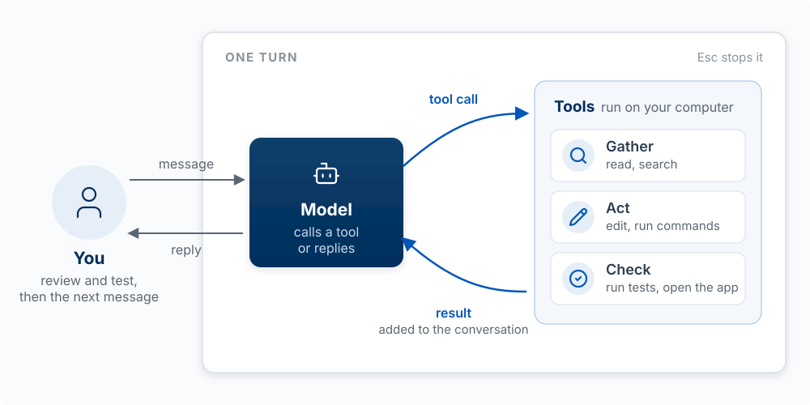
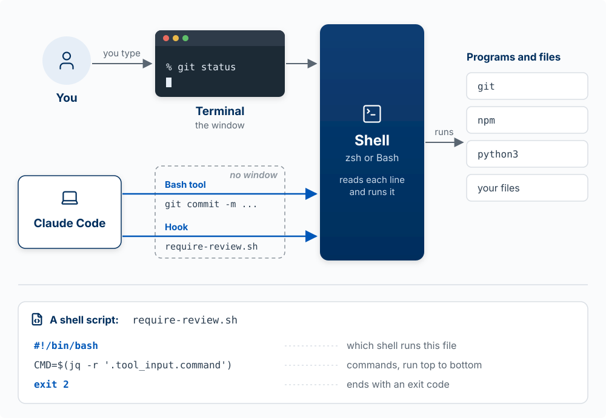
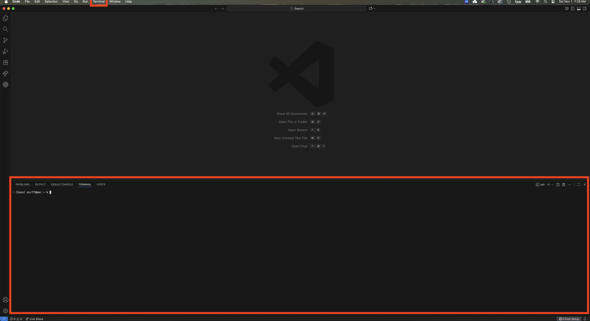
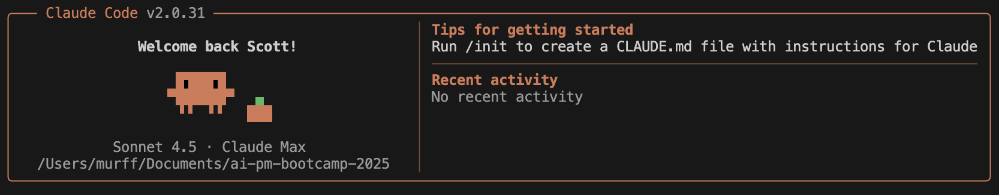
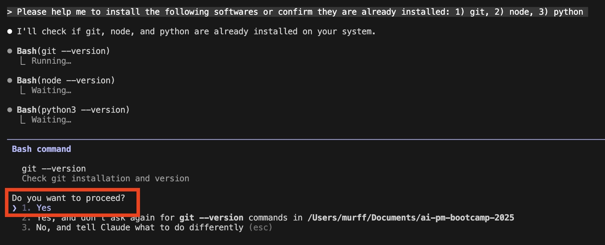

This page explains what a coding agent does when you give it a task: the loop it runs, the tools it uses, and the split between the model and the program around it. It also covers the command line and VS Code at the level you need to read what the agent is doing. Read it if you have used ChatGPT or Claude in a browser but not Claude Code. Skip it if you already know what a tool call is and why the same model behaves differently in claude.ai and in your terminal.

## What Makes an Agent an Agent

**An agent is a model in a loop with tools.** The **model** is a large language model (LLM), such as Claude: a program that takes in text and images and writes text back. Every way of using Claude (web, mobile, desktop, and Claude Code) runs the same models. What differs is the **harness**, the program around the model, and how far it lets the model reach. In the web and mobile chat apps, Claude can run code and make files, but only in a sandbox on Anthropic's servers, and it reaches services such as Gmail and Google Drive through connectors. The desktop app and the terminal (Claude Code) also work on your computer: they read your files, run commands in your terminal, and see what happened. The terminal adds scripts and automated runs, such as a check that runs on every pull request.

{#fig-agent-iceberg fig-alt="An iceberg at a waterline. Above the water is a small pale tip, bracketed as The model, text and images in, text out. Below the water is a much larger, irregular body, bracketed as The harness, in three bands that get darker with depth. Top band: a cloud sandbox and connectors; code runs on Anthropic's servers, with connectors to Gmail and Google Drive. Middle band: your computer; your files, your terminal, and apps on your screen. Bottom band: scripts and CI; claude -p and GitHub Actions. On the left, three vertical bars, each under an icon, start at the waterline and show how deep each way of using Claude reaches. Web and mobile chat stops at the bottom of the top band. The desktop app stops at the bottom of the middle band. The terminal, or CLI, goes a little further, into the bottom band." width="100%"}

A chatbot can write you a PRD. An agent can read your repo (short for repository, the folder that holds your project's code), write the code, run it, watch it fail, fix it, and deploy the result. That difference is why the workshop runs in a terminal instead of a browser tab.

### The agent loop: gather context, act, check

Every agent turn has three phases. Claude Code's documentation names them **gather context, take action, and verify results**, and the loop repeats until the task is done or you interrupt.

{#fig-agent-loop fig-alt="Two loops. On the left, You: you send a message into one turn and get a reply back, then review and test before the next message. Inside the turn, the Model either calls a tool or replies. A tool call goes to Tools, which run on your computer and come in three kinds: Gather (read, search), Act (edit, run commands), and Check (run tests, open the app). The result is added to the conversation and goes back to the model. Esc stops a turn." width="100%"}

| Phase | What the agent does | The tools it uses | What goes wrong here |
|---|---|---|---|
| **Gather context** | Reads files, searches the code, reads your instructions | Read, search, CLAUDE.md, web fetch | It never looked at the file that mattered, or your instruction was not in front of it |
| **Act** | Changes something | Edit, Write, Bash (run a command) | It edited the wrong file, or ran a command you did not want |
| **Check** | Looks at the result of its action | Run the tests, run the app, read the error output | It skipped the check, or the check could not detect the problem |

**Worked example.** You tell Claude Code: "The delete button on my to-do app doesn't work." A good run looks like this:

1. *Context:* it reads `app.py` (the app's code), finds the delete handler (the code that runs when the button is clicked), and reads `todos.json` (the file where the to-dos are saved).
2. *Act:* it notices the handler removes the item from the list but never saves the file, and adds the save.
3. *Check:* it runs the app (or a small test, a short program that checks one behavior automatically), deletes an item, reloads, and confirms the item is gone.
4. The check passes, so it stops and reports.

Now three bad runs, one per phase. It "fixes" the wrong button because it never opened `app.py` (context). It rewrites the whole file and breaks the add feature (act). It announces "Fixed!" without ever reloading the app (check). **When a result is wrong, ask which phase failed.** Did it lack context, take the wrong action, or skip the check? Each has a different fix: give it the file or the rule, narrow the request, or give it a way to verify.

You are part of the loop too. You can interrupt at any point (press `Esc`), add context, or redirect. Treat the agent like a fast, capable new hire with no memory who takes you literally: brief it well, check its work, and do not assume it knows what you did not tell it. The comparison fails in one place: unlike a new hire, the agent does not learn from yesterday unless the lesson is written down where it will read it, in CLAUDE.md (see [Directing the Agent](02-directing-the-agent.qmd)).

### Tools: how the agent acts on your computer

**The model only writes text. Every file it reads, every edit, and every command happens because Claude Code ran a tool the model asked for.** A **tool** is a function Claude Code offers the model: a name, a description of what it does, and the inputs it takes. `Read` takes a file path. `Edit` takes a file path, the text to replace, and the new text. `Bash` takes a command.

{#fig-one-tool-call fig-alt="Two columns joined by four numbered arrows. Left column: the model, which writes text only. Right column: Claude Code, which runs on your computer. Arrow 1 goes from Claude Code to the model, carrying a card titled tools the model can call: Read(file_path), Edit(file_path, old, new), Bash(command), plus MCP tools. Arrow 2 goes from the model to Claude Code, carrying a tool call card: Edit, file app.py, old todos.remove(item), new todos.remove(item) save(todos); under the model, its reply ends here. Step 3 sits on the Claude Code column as three stacked cards: Hook, can block it; Permission, allow, ask you, deny; Run the tool, app.py changes. Arrow 4 goes from Claude Code back to the model, carrying a next request card: the whole conversation so far plus Updated app.py, or an error; under the model, reads it all, then calls again or replies." width="100%"}

One tool call, step by step, using the delete-button fix above:

1. **The list.** With every request, Claude Code sends the model the tools it can call and what each one takes. The model can only use what is on this list.
2. **The call.** The model writes a tool call: text in a fixed format naming the tool and its inputs (`Edit`, the file `app.py`, the old line, the new lines). Its reply ends there. Nothing has changed on your computer yet.
3. **The checks, then the run.** Claude Code, the program running on your computer, receives the call. A hook can block it, and a permission rule either allows it, asks you, or denies it. Only then does Claude Code run the tool, and the file changes. [The Harness](11-the-harness.qmd) covers hooks and permissions.
4. **The next request.** What the tool returned (a file's contents, a command's output, or an error message) is added to the conversation as text, and Claude Code sends a new request: the whole conversation so far, plus the result. The model keeps nothing between requests, so it rereads everything and decides the next step: another tool call, or a reply to you. The loop ends when the model replies without a tool call.

The tools you will see most often:

| Tool | What it does | Asks permission by default |
|---|---|---|
| `Read` | Reads a file | No |
| `Edit` | Replaces specific text in a file | Yes |
| `Write` | Creates a file, or overwrites one | Yes |
| `Bash` | Runs a terminal command: tests, installs, git, searches | Yes |
| `WebFetch`, `WebSearch` | Reads a web page; searches the web | Yes |
| `Agent` | Starts a subagent with its own context window | No |
| `Skill` | Runs a skill | Yes |

Source: the [Claude Code tools reference](https://code.claude.com/docs/en/tools-reference). Four things follow from this mechanism:

- **You can see and control every action.** Each tool call appears in the transcript, and permissions and hooks act on tool calls, so they can stop any action before it runs.
- **The model knows only what tool results put in front of it.** If it never called `Read` on the file that mattered, it is guessing about that file.
- **More tools means more ability.** An MCP server, a small program that connects Claude Code to another system, adds tools to the list. Connect the Playwright server and the model gains tools that open a browser and click.
- **Your own product can work the same way.** When you give a model tools through the API (the interface your own code uses to send requests to a model), your code plays Claude Code's part: it receives the call, decides whether to run it, and sends the result back.

::: {.callout-tip title="Try it"}
Ask Claude Code to make a small change in a project, then watch the transcript instead of the result. Label each step it takes as context, action, or check. Did it check its own work before saying it was done? If not, what check would you have asked for?
:::

### The model and the harness

**The model reads text and images and writes text. The harness is the software around the model: it builds each request, sends it to the model, and carries out the tool calls the model asks for.** Claude Code is a harness, and it runs on your computer. In web and mobile chat, the harness runs on Anthropic's servers.

On its own, the model has three limits. It writes only text. It stores nothing from one request to the next, so everything it should know has to be in the request. And it has no access to your computer. The harness makes up for all three.

{#fig-model-and-harness fig-alt="Two regions. A large box labeled your computer holds you, the harness, and your files and terminal. A smaller box outside it, labeled Anthropic's servers, holds the model: text and images in, text out, stores nothing between requests. Inside the harness, labeled Claude Code, a top row titled builds each request: conversation so far, system instructions, CLAUDE.md, tool list. An arrow labeled request goes from the tool list out to the model. An arrow labeled reply comes back into a bottom row titled handles each reply, read right to left: find tool calls, check the call, run the tool, add the result. Run the tool sends an action down to your files and terminal, whose output returns to add the result. Add the result sends the result, as text, up into the conversation. You send a message into the conversation; when the reply has no tool call, the harness shows it to you." width="100%"}

The harness's jobs, in the order they happen on each request:

| Job | What it does | Example in Claude Code |
|---|---|---|
| **Build the request** | Puts together everything the model will see: system instructions, your CLAUDE.md, the list of tools, and the conversation so far | Your CLAUDE.md is in every request of every session, which is why the model follows it |
| **Send and receive** | Sends the request to the model and receives the text the model writes back | Each message you type, and each tool result, starts a new request |
| **Find tool calls** | Reads the reply for tool calls. If there are none, it shows you the reply and the turn ends | The reply "The bug is fixed" with no tool call comes back to you |
| **Check the call** | Runs your hooks and permission rules on the tool call, which can allow it, ask you, or block it | The approval prompt before an `Edit` |
| **Run the tool** | Runs the tool on your computer | `Bash` runs your tests in your terminal |
| **Add the result** | Adds the tool's output to the conversation as text, then sends the next request | The failing test's error message, which the model reads next |
| **Manage the context window** | When the conversation nears the limit, clears old tool outputs, then summarizes the conversation (compaction) | Automatic compaction; `/compact` when you want it now |
| **Give you an interface** | Shows you the conversation and the tool calls, and takes your messages, approvals, and `Esc` | The terminal, the VS Code panel, the desktop app |

Sources: [How Claude Code works](https://code.claude.com/docs/en/how-claude-code-works) and the [Claude Code glossary](https://code.claude.com/docs/en/glossary), which defines the agentic harness as "the tools, context management, and execution environment that turn a language model into a capable coding agent."

Three things follow for a builder:

- **The same model behaves very differently in different harnesses.** In the claude.ai chat window, Claude answers you but cannot open the files on your laptop. In Claude Code, the same model reads, edits, and runs your project. In your own app, the model can do only what your code offers it as tools.
- **When an agent fails, ask whether the model or the harness was the limit.** If the right file and instructions were in the request and the model still reasoned badly, the model was the limit: give it a smaller task, clearer instructions, or a stronger model (`/model`). If the file was never read, the tool was missing, a permission blocked the call, or compaction dropped an early instruction, the harness was the limit, and you can usually fix that yourself.
- **What you configure in Claude Code is the harness.** CLAUDE.md changes what goes into every request. Permissions and hooks change what happens to a tool call. Skills and MCP servers add to what the model can ask for. You cannot change the model's training; you can change everything around it. The Workshop pages, starting with [The Harness](11-the-harness.qmd), are about that configuration.

::: {.callout-tip title="Try it"}
In Claude Code, run `/context`. It lists what the harness has put into the context window by category: system prompt, tools, MCP tools, memory files (your CLAUDE.md), skills, and messages. Then ask "What files are in my project folder?" in the claude.ai chat window and in Claude Code. Explain the difference between the two answers in one sentence about the harness.
:::

## The Command Line

Most of what a coding agent does happens on the [command line](https://en.wikipedia.org/wiki/Command-line_interface): a text-based way to control your computer by typing commands instead of clicking. The program that shows it is a **terminal**: Terminal on macOS; PowerShell or Git Bash on Windows; or the terminal panel built into VS Code.

The terminal is only the window. The program that runs the commands is the **shell** (zsh is the default on a Mac; Bash is the default on Linux and in Git Bash on Windows). When you type `git status`, the terminal passes the line to the shell and the shell runs the `git` program. Claude Code sends commands to the same shell directly, with no window, through its `Bash` tool.

{#fig-terminal-and-shell fig-alt="You type into a terminal window showing the command git status. The terminal passes the line to a tall box labeled Shell, zsh or Bash, reads each line and runs it. The shell runs programs and files: git, npm, python3, and your files. Below, Claude Code sends two commands straight to the same shell, through an empty dashed outline labeled no window: from the Bash tool, git commit -m, and from a hook, require-review.sh. At the bottom, a shell script named require-review.sh with three lines labeled: #!/bin/bash, which shell runs this file; CMD equals a jq command, commands, run top to bottom; exit 2, ends with an exit code." width="100%"}

The command line was always the most powerful way to control a computer: commands are exact, they can be chained, and they can be saved in a file and run again. It was also the hardest to learn, which is why graphical interfaces took over. An agent removes the hard part. You describe what you want in plain English, and the agent writes and runs the commands. That is why Claude Code is built as a command-line program. The same access that lets an agent do anything on your computer also lets it break anything, so you approve or reject its commands based on whether you can read them.

You do not need to memorize commands. You need to recognize the core ones:

| Command | What it does |
|---|---|
| `pwd` | Print the folder you are in |
| `ls` | List files in the current folder (`ls -la` includes hidden files like `.claude`) |
| `cd foldername`, `cd ..`, `cd ~` | Move into a folder, up one level, or to your home folder |
| `mkdir my-project` | Make a folder |
| `cat file.txt` | Show a file's contents |
| `cp a.txt b.txt` | Copy a file |
| `rm file.txt`, `rm -r folder` | Delete a file, or a folder and everything in it |
| `open .` (macOS), `explorer.exe .` (Windows) | Open the current folder in Finder or File Explorer |

Three things to watch for:

- Paths with spaces need quotes: `cd "My Folder"`.
- macOS and Linux are usually case-sensitive; Windows is not.
- `rm` deletes permanently. Nothing goes to the Trash. Read it carefully when an agent asks to run it.

A **package manager** installs software from the command line, so you type one command instead of clicking through an installer. On macOS the standard one is [Homebrew](https://brew.sh); on Windows 10 and 11, `winget` comes pre-installed. When Claude Code installs `git`, `node`, or `python` for you, it is calling one of these.

::: {.callout-note collapse="true" title="Windows only: set up Git Bash so these commands work"}
In a VS Code terminal, run `winget install --id Git.Git -e --source winget`, then confirm with `git --version`. In VS Code press `Ctrl + Shift + P`, choose **Terminal: Select Default Profile**, pick **Git Bash**, and open a new terminal (`Ctrl + ~`). It should start with `bash$` or `MINGW64` instead of `PS`. The commands above then work as on macOS.
:::

## VS Code

Visual Studio Code is a free code editor from Microsoft. It puts a file browser, an editor, a built-in terminal, and the Claude Code extension in one window, which makes it a convenient place to run Claude Code and watch the files it changes. Installation is in [Setup](00-setup.qmd).

## Claude Code

Claude Code is Anthropic's coding agent. You describe what you want in plain language; it reads your project, plans, edits files, runs commands and tests, and reports back, asking your permission for actions you have not pre-approved. It will not build a polished, complicated application by itself, but it does much of the construction while you direct it.



You install it in [Setup](00-setup.qmd): a Claude Pro (or higher) subscription, the install script in a terminal, then `claude` to sign in. In VS Code, the terminal opens as a pane inside the editor:

After you sign in, you see the welcome screen:

When Claude wants to run something, such as installing git, node, or python, it asks first and you press **Enter** to approve:

That approval prompt is the permission system at work. [Directing the Agent](02-directing-the-agent.qmd) covers what goes into each request, and [The Harness](11-the-harness.qmd) covers how to decide what the agent may do without asking. Claude Code also runs in the VS Code extension, the desktop app, and the cloud; [Surfaces](10-surfaces.qmd) compares them.

For the longer version of this material, including the history of command-line and graphical interfaces, see [Building with AI Agents](https://byu-strategy.github.io/product-management/01-building-with-ai-agents.html) in the Product Management book.
