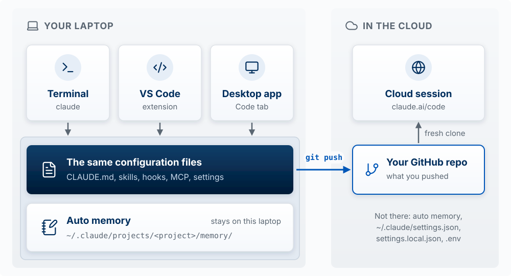

This segment covers the places you can run Claude Code: the terminal, the VS Code extension, the desktop app, and a cloud session at claude.ai/code. You probably already use one of them. The goal is to know what is the same on all of them, what each one adds or lacks, and how to choose. It ends with how the other coding agents you may use at work (Codex, Copilot CLI, Antigravity CLI) map onto the same ideas, and with Claude in Chrome.

::: {.callout-note}
## Sources and dates

Checked on October 10, 2026 against Anthropic's [desktop app documentation](https://code.claude.com/docs/en/desktop), [CLI reference](https://code.claude.com/docs/en/cli-reference), [commands reference](https://code.claude.com/docs/en/commands), and [VS Code page](https://code.claude.com/docs/en/vs-code), and against the vendors' docs linked in each section. These products change every few weeks. When this page and the docs disagree, the docs are right.
:::

## One engine, many surfaces

**Claude Code is one engine with several front ends.** The agent loop, the tools, and the configuration are the same everywhere. What changes is the window around it and a short list of features each one adds or lacks.

| Surface | What it is | Pick it when |
|---|---|---|
| **Terminal (CLI)** | `claude` typed in any terminal, including VS Code's | You want every feature, scripting (`claude -p`), or a terminal workflow. The docs call it the most complete surface |
| **VS Code extension** | A chat panel in the editor, opened from the Spark icon | You want inline diffs next to your code and to stay in the editor |
| **Desktop app** | The Code tab in the Claude desktop app | You want a visual diff viewer, an app preview, and several sessions side by side |
| **Cloud session** ([claude.ai/code](https://claude.ai/code), formerly Claude Code on the web) | A session that runs in Anthropic's cloud on a fresh clone of your GitHub repo | A long task that should keep running after you close the laptop |

**What carries across.** The terminal, the VS Code extension, and the desktop app read the **same configuration files** on your machine: `CLAUDE.md`, skills, hooks, MCP servers, and `settings.json` ([shared configuration](https://code.claude.com/docs/en/desktop#shared-configuration)). Learn them once on one surface and you have learned them for all three. [The Harness](11-the-harness.qmd) covers each of these files.

**A cloud session sees only what you pushed.** It runs on another computer, so it sees what you have committed and pushed to GitHub, such as the project `CLAUDE.md` and `.claude/settings.json`. It does not see what lives only on your laptop: `~/.claude/settings.json`, `.claude/settings.local.json`, auto memory, and your `.env` file.

{#fig-one-engine-surfaces fig-alt="Two panels. Your laptop: Terminal, VS Code extension, and Desktop app cards each point down to one shaded area holding two boxes. The first is a dark bar, The same configuration files: CLAUDE.md, skills, hooks, MCP, settings. Below it is a separate box, Auto memory, stored under ~/.claude/projects/ in your home folder, labeled stays on this laptop. A highlighted arrow labeled git push runs from the configuration bar to a card in the cloud panel, Your GitHub repo, what you pushed; no arrow leaves auto memory. From the repo, an arrow labeled fresh clone points up to Cloud session, claude.ai/code. A note says not there: auto memory, ~/.claude/settings.json, settings.local.json, .env." width="100%"}

Three gotchas people hit:

- The VS Code extension bundles its own private copy of Claude Code. Installing only the extension does **not** let you type `claude` in a terminal; that needs the standalone install from [Setup](00-setup.qmd).
- `Shift+Tab` cycles permission modes in the terminal. The desktop app uses a mode menu instead.
- Some terminal commands, such as `/permissions`, are not available in the desktop app; you edit the settings file instead.

::: {.callout-tip title="Try it"}
Predict, then check: you add a line to your project's `CLAUDE.md` while working in the terminal. Will a session in the VS Code extension see it? Will a cloud session at claude.ai/code see it if you have not committed and pushed the file? (Yes; no.)
:::

## The CLI in VS Code or the desktop app? {#cli-in-vs-code-or-the-desktop-app}

Most people end up choosing between two setups: the **Claude Code CLI in VS Code's terminal** (see [below](#claude-code-in-the-vs-code-terminal)) and the **Claude desktop app's Code tab**. Many who started with the CLI in VS Code have moved to the app, and the app has added much of what used to keep them in the editor. This scorecard compares the two.

| What you need to do | Claude Code CLI in VS Code | Claude desktop app (Code tab) |
|---|---|---|
| Find and open files | 2: Explorer, `Cmd+P` search, and `Cmd`-click any file path in the terminal to open it at that line | 1: click a path in the chat or diff to open it in a file pane; **Open in** sends it to your editor; no file search documented |
| Edit code yourself | 2: full editor | 1: small edits in the file pane |
| Review what the agent changed | 1: diffs open in VS Code's diff viewer; you can't send line comments back | 2: diff view with line comments Claude acts on, and a code review card |
| See the running app, and let the agent check it | 1: you open it in your browser; Claude can drive Chrome with `claude --chrome` or an MCP server | 2: Browser pane; Claude checks its own work after each edit |
| Preview other files (HTML, PDF, images) | 1: Markdown and images; other types need extensions | 2: HTML, PDF, image, and video files open in the Browser pane |
| Feed the agent your editor's context | 2: your selection, the open file, and the Problems panel | 1: `@` mentions and attachments; no editor connection |
| Run several agents at once | 1: one terminal per session; `claude -w` for a worktree; `claude agents` for background sessions | 2: sidebar of sessions, a worktree checkbox, split view |
| Have sessions work together | 2: messages between local sessions, and agent teams with a shared task list | 1: messages between app sessions only; no agent teams |
| Work across several folders | 2: `--add-dir` and `/add-dir`, which also load each folder's skills | 1: a settings file you edit by hand or through Claude; file access only, no screen for it |
| Every command, scripts, and CI | 2: all commands and flags, `claude -p` | 1: a subset; no `-p`; panel commands such as `/permissions` don't open |
| Set safety rules | 2: `/permissions` and `/hooks` panels, plus the settings files | 1: the same settings files, edited by hand; mode menu |
| Use editor extensions | 2: the whole VS Code marketplace | 0: none |
| Keep work going when you step away | 1: `/remote-control`, `claude --cloud`, `/schedule` | 2: all of those, plus notifications, PR auto-fix, scheduled tasks, Dispatch from your phone |
| Setup | 1: VS Code, the CLI, and the extension | 2: one download |
| **Total (of 28)** | **22** | **19** |

Scores are 2 (does this well), 1 (does it partly, or with extra setup), or 0 (cannot). They are Scott's judgment from what each product's documentation says it does; no timed tests were run. Each row is worth the same, which may not match how you work: weight the rows you do most.

**What the scores show.** Each setup is better at different jobs:

- **VS Code is better when you work on the code yourself.** Finding a file, clicking a path in Claude's output to open the exact line, editing it with full editor support, using extensions, and handing Claude your editor's errors and selection all happen in one window. It also has every command and flag, and it is the better setup for work that spans several folders or several coordinating sessions.
- **The app is better when you direct and review the agent.** Commenting on a diff line by line, watching Claude test its own change in the Browser pane, previewing a PDF or HTML file, and running several sessions side by side take less setup in the app than in VS Code.

The more of your time goes to reading and editing code, the more useful VS Code is. The more of it goes to giving instructions and reviewing results, the more useful the app is. Many product managers spend most of their time in the second group. You do not have to pick one: both read the same `CLAUDE.md`, skills, and settings, `/desktop` moves a session from the terminal to the app, and **Open in** sends any file from the app to VS Code.

The documentation's own advice: "use Desktop when you want to manage parallel sessions in one window, arrange panes side by side, or review changes visually. Use the CLI when you need scripting, automation, or prefer a terminal workflow" ([Coming from the CLI](https://code.claude.com/docs/en/desktop#coming-from-the-cli)). The rest of this workshop shows commands in the terminal because they are shorter to write down; each one has an app equivalent unless the tables below say otherwise.

## Everyday controls

The desktop app "runs the same underlying engine with a graphical interface." Shortcuts are for macOS; on Windows, use `Ctrl` in place of `Cmd`. Sources: [CLI flag equivalents](https://code.claude.com/docs/en/desktop#cli-flag-equivalents), [keyboard shortcuts](https://code.claude.com/docs/en/desktop#keyboard-shortcuts), [commands](https://code.claude.com/docs/en/commands).

| What you want | Terminal | Desktop app |
|---|---|---|
| Change permission mode | `Shift+Tab` cycles modes | Mode selector next to the send button, or `Cmd+Shift+M`. `Shift+Tab` does nothing here |
| Change model | `/model` | Model dropdown next to the send button, or `Cmd+Shift+I` |
| Change effort | `/effort` | Effort menu, `Cmd+Shift+E` |
| Stop Claude | `Esc` | `Esc` or the stop button |
| Correct Claude while it works | Type and press Enter | Same |
| Point at a file | `@file` | `@file` with autocomplete (local and SSH sessions only) |
| Add an image or PDF | Paste an image | Attach images, PDFs, and other files with **+**, or drag them in |
| See context and plan usage | `/context`, `/usage` | The [usage ring](https://code.claude.com/docs/en/desktop#check-usage) next to the model picker |
| Summarize to free context | `/compact` | `/compact` |
| Run a skill | `/skill-name` | `/skill-name`, or **+** then **Slash commands** |
| Ask a side question that does not change the session | `/btw` | `/btw`, or `Cmd+;` |
| Give the session its own copy of the project | `claude -w name` (a git worktree) | Check **worktree** when you start the session |
| See every tool call | `--verbose` | **Verbose** view mode; `Ctrl+O` cycles Normal, Thinking, Verbose |

**Permission modes** are the same on both surfaces, with two exceptions ([Choose a permission mode](https://code.claude.com/docs/en/desktop#choose-a-permission-mode)). **Bypass permissions** is hidden in the app until you turn it on (Settings, then Claude Code, then "Allow bypass permissions mode"). **`dontAsk`**, a mode that runs only pre-approved tools and refuses the rest, exists only in the terminal. A mode you pick in the app is remembered for that folder, except Plan, which lasts only for the current session. Cloud sessions offer Accept edits, Plan, and Auto. [The Harness](11-the-harness.qmd) covers how to choose a mode by blast radius.

**Commands that open a panel**, such as `/permissions`, reply in the app with `isn't available in this environment`. Edit the settings file instead, or run the command in the terminal. `/config` opens the app's Settings ([What's not available in Desktop](https://code.claude.com/docs/en/desktop#whats-not-available-in-desktop)).

## What the app adds

| Feature | What it does |
|---|---|
| [**Diff view**](https://code.claude.com/docs/en/desktop#review-changes-with-diff-view) | Click the `+12 -1` indicator to see every changed file. Click a line to leave a comment; send all comments with `Cmd+Enter` and Claude makes the changes |
| [**Code review card**](https://code.claude.com/docs/en/desktop#review-your-code) | `/code-review` shows findings by file, with **Walk through in diff**, **Fix this one**, and **Apply fixes** |
| [**Browser pane (app preview)**](https://code.claude.com/docs/en/desktop#preview-your-app) | Claude starts your dev server and opens the app in a built-in browser. With **auto-verify** on (the default), it takes screenshots, clicks, and fills forms after each edit to check its own work. Server settings are saved in `.claude/launch.json` |
| [**Integrated terminal**](https://code.claude.com/docs/en/desktop#run-commands-in-the-terminal) | `` Ctrl+` `` opens a terminal in the session's folder, so `npm test` or `git status` sees the files Claude is editing |
| [**File pane**](https://code.claude.com/docs/en/desktop#open-and-edit-files) | Click a path to open the file and make a small edit yourself |
| [**Parallel sessions**](https://code.claude.com/docs/en/desktop#work-in-parallel-with-sessions) | **+ New session** or `Cmd+N`; sessions are listed in the sidebar. Check **worktree** to give a session its own copy of the project ([Agent Team Kit](12-agent-team-kit.qmd) covers why parallel sessions need separate copies) |
| [**Pull request status**](https://code.claude.com/docs/en/desktop#monitor-pull-request-status) | After you open a pull request, a status bar shows its CI checks. Optional: Claude fixes failing checks, or merges once they pass. Requires the GitHub CLI (`gh`) |
| [**Connectors**](https://code.claude.com/docs/en/desktop#connect-external-tools) and [**plugins**](https://code.claude.com/docs/en/desktop#install-plugins) | **+** then **Connectors** adds Slack, GitHub, Linear, Google Calendar, and others; connectors are MCP servers added without editing a file |
| [**Scheduled tasks**](https://code.claude.com/docs/en/desktop-scheduled-tasks) | Run a task on a schedule. In the terminal, use a cron job or CI |
| **Notifications** | The app notifies you when a session you are not viewing finishes |

Worktrees the app creates go in `.claude/worktrees/` inside your project. Files in `.gitignore`, such as `.env`, are not copied into a worktree; list them in a [`.worktreeinclude`](https://code.claude.com/docs/en/worktrees) file at the project root to have them copied.

## What only the terminal does

Sources: [Feature comparison](https://code.claude.com/docs/en/desktop#feature-comparison), [CLI reference](https://code.claude.com/docs/en/cli-reference).

| Terminal only | Why it matters |
|---|---|
| `claude -p` and `--output-format` | Run Claude from a script or CI. The app is interactive only |
| `dontAsk` permission mode | Runs only pre-approved tools |
| Commands that open a panel, such as `/permissions` | In the app, edit the settings file instead |
| Background sessions (`claude --bg`, `claude agents`) | Start a session that keeps running while you use the terminal for something else, and watch them all in one list |
| Agent teams | A lead Claude assigns tasks to teammate sessions from a shared list |
| Amazon Bedrock and other cloud providers without extra setup | Matters if your company buys Claude through a cloud provider instead of a Claude plan |

## Moving a session between surfaces

Sources: [Coming from the CLI](https://code.claude.com/docs/en/desktop#coming-from-the-cli), [Continue in another surface](https://code.claude.com/docs/en/desktop#continue-in-another-surface).

| From | To | How |
|---|---|---|
| Terminal | Desktop app | Type `/desktop` (alias `/app`) in the session. Claude saves it, opens it in the app, and exits the terminal. From the shell, `claude --desktop --continue` opens your most recent session in the app |
| Terminal | Desktop app, later | Close the terminal session, then type `/resume` in the app's prompt box and pick it from the list |
| Desktop app | Terminal | `claude --resume` finds the session, because the app continued the same session instead of making a copy |
| Desktop app | Cloud | Session menu, then **Open in**, then **Cloud**. The conversation carries over as a summary |
| Cloud | Terminal | `claude --teleport`, or `/teleport` in a session, fetches the cloud session's branch and conversation |

`/desktop` and `claude --desktop` work on macOS and Windows (x64) when you sign in with a Claude subscription. They do not work with an API key.

## Working across several folders {#working-across-several-folders}

Sources: [working directories](https://code.claude.com/docs/en/permissions#working-directories), [additional directories](https://code.claude.com/docs/en/permissions#additional-directories-grant-file-access-not-configuration), [CLAUDE.md from additional directories](https://code.claude.com/docs/en/memory).

A session starts with access to one folder. Some work spans several: a product repo and a folder of research notes, or one folder of instructions that should apply to many projects. There are three ways to add folders, and they do different things:

| How | Lasts | Gives file access | Loads that folder's skills, subagents, and commands | Works in the desktop app |
|---|---|---|---|---|
| `claude --add-dir <path>` at launch | This session | Yes | Yes | No. The app has no equivalent for local sessions; cloud sessions can add more repos with **+** |
| `/add-dir <path>` in a session | This session | Yes | Yes | Not documented. The app refuses only commands that have no argument form, so it may work; try it |
| `permissions.additionalDirectories` in a settings file | Every session that reads that file | Yes | No: "file access only" | Yes, because the app reads the same settings files |

- **An added folder's `CLAUDE.md` does not load by default**, whichever way you add it. Setting the environment variable `CLAUDE_CODE_ADDITIONAL_DIRECTORIES_CLAUDE_MD=1` turns it on for folders added with `--add-dir` or `/add-dir`. A simpler route that works everywhere: import the other folder's file from your project's `CLAUDE.md` with a line such as `@../notes/CLAUDE.md`.
- **The app has no screen for this.** To set it up from the app, ask Claude to add the folders to `permissions.additionalDirectories` in the project's `.claude/settings.json` (the built-in `/update-config` skill does this). The app is built around one project folder per session; working across many is easier from the terminal.

## Sessions that talk to each other {#sessions-that-talk-to-each-other}

Sources: [tools reference](https://code.claude.com/docs/en/tools-reference) (`SendMessage`, `ListAgents`), [work across sessions](https://code.claude.com/docs/en/desktop#work-across-sessions).

| Feature | How it works | Terminal | Desktop app |
|---|---|---|---|
| **Subagents** | One way: Claude gives a subagent a task and gets back one report | Yes | Yes |
| **Cross-session messaging** | Back and forth: one session sends another a message with `SendMessage`; the other reads it when its current work finishes and can reply. `/list-agents` (alias `/peers`) shows who you can reach | Yes: your other local sessions, plus cloud and remote sessions while Remote Control is connected | Yes, in plain language ("tell the payments session the schema changed"), but only between sessions the app runs |
| **Agent teams** | A lead Claude assigns tasks to teammate sessions from a shared task list, and they message each other | Yes | No |

The limit is the boundary between surfaces. Through the app, Claude "doesn't see cloud sessions, or sessions you started from the terminal CLI or the VS Code extension, even in worktrees of the same project." If several sessions need to coordinate, run them all in the terminal or all in the app. [The Harness](11-the-harness.qmd) and [Agent Team Kit](12-agent-team-kit.qmd) use these features.

## Things that surprise people {#things-that-surprise-people}

From the [troubleshooting](https://code.claude.com/docs/en/desktop#troubleshooting) and [local sessions](https://code.claude.com/docs/en/desktop#local-sessions) sections:

- **The app runs its own copy of Claude Code.** Its version can differ from the `claude` command in your terminal, and updating one does not update the other. `/status` in the app shows which version a session runs.
- **The app does not read all of your shell setup.** On macOS, an app opened from the Dock reads `PATH` from `~/.zshrc` but not other variables you export there. If Claude cannot find `npm` or `node`, check that they work in your terminal, then restart the app. To give local sessions and dev servers an environment variable, use the local environment editor (the gear icon next to **Local**).
- **A cloud session sees only what you pushed.** Your `.env` and anything uncommitted stay on your laptop.

## Claude Code in the VS Code terminal {#claude-code-in-the-vs-code-terminal}

Sources: [Run CLI in VS Code](https://code.claude.com/docs/en/vs-code#run-cli-in-vs-code), [the built-in IDE MCP server](https://code.claude.com/docs/en/vs-code#the-built-in-ide-mcp-server).

Anthropic's docs say: "If you need a CLI-only feature, run `claude` in VS Code's integrated terminal." You get every terminal feature, connected to the editor. The Claude Code extension, which `claude` installs the first time you run it there, runs a small local MCP server, and the CLI connects to it automatically. That connection adds:

| What you get | Details |
|---|---|
| Diffs open in VS Code's diff viewer | Instead of as text in the terminal |
| Your selection and the open file go with each prompt | The transcript shows a line such as `⧉ Selected 12 lines from app.ts` |
| Claude can read the Problems panel | Through a tool named `mcp__ide__getDiagnostics`: the errors and warnings your language extensions report |

A terminal app outside VS Code gets the same connection when you type `/ide` while VS Code is open. A plain terminal with no editor gets the CLI alone.

Extensions that check code, such as ESLint, the TypeScript checker, and Pylance, report to the Problems panel, so Claude can see that an edit broke a type or a lint rule without running a build. Claude does not use an extension's commands directly; to let Claude act on an outside system such as GitHub or Supabase, add an MCP server ([The Harness](11-the-harness.qmd)).

Three things to know:

- **Selected text is sent from any file.** The extension's chat panel holds back selected text from gitignored and excluded files. The CLI in VS Code's terminal "sends your selected text whatever the file," so if you highlight a line in `.env`, Claude receives it. A `Read(./.env)` deny rule stops both the selection and the open-file notice.
- **The extension does not install `claude`.** It bundles a private copy for its chat panel. Typing `claude` in a terminal needs the standalone install.
- **Running `claude` in VS Code's terminal reinstalls the extension** if you removed it. Turn off **Auto-install IDE extension** in `/config` to stop that.

## Other coding agents

Some of you use Codex or GitHub Copilot at work. Three other coding agents run in the terminal on the same agent loop ([How Agents Work](01-how-agents-work.qmd)): OpenAI's **Codex**, GitHub's **Copilot CLI**, and Google's **Antigravity CLI** (which replaced Gemini CLI for individual users on June 18, 2026). The model and the harness differ, so the commands, file names, and safety controls differ too.

Every cell below was checked against the vendors' documentation on October 10, 2026: [Claude Code](https://code.claude.com/docs/en/cli-reference), [Codex](https://learn.chatgpt.com/docs/developer-commands?surface=cli), [Copilot CLI](https://docs.github.com/en/copilot/reference/copilot-cli-reference/cli-command-reference), and [Antigravity CLI](https://antigravity.google/docs/cli/reference). "Not listed" means the reference does not mention it, which is different from "does not exist." The full comparison, including every command, every tool, and every key, is in the [Claude Code and Other Coding Agents appendix](https://byu-strategy.github.io/product-management/A2-coding-agents-compared.html).

### The concepts transfer

Everything in [Directing the Agent](02-directing-the-agent.qmd) and [The Harness](11-the-harness.qmd) is a property of agents, so none of it is specific to Claude. The agent knows only what is in its context window. A standing rule belongs in a file the agent re-reads every session. A procedure you repeat belongs in a skill. Advice in an instruction file can be ignored; a rule or hook that sits between the model and the tool cannot. An action's blast radius decides how much you let the agent do without you. The tables below change only the names.

### Which one can you use?

| | Claude Code | Codex | Copilot CLI | Antigravity CLI |
|---|---|---|---|---|
| Sign in with | Claude account | ChatGPT account | GitHub account | Google account |
| Free option | None; needs Pro, Max, Team, or Enterprise, or an API key | ChatGPT Free ([pricing](https://learn.chatgpt.com/docs/pricing)) | Copilot Free ([plans](https://docs.github.com/en/copilot/concepts/billing/individual-plans)) | Personal Google account, with a weekly quota ([plans](https://antigravity.google/docs/plans)) |
| Can it use Claude models? | Yes | No | Yes, on paid plans; Free picks the model for you | Yes, on Google AI Pro (paid), Ultra, and Enterprise ([models](https://antigravity.google/docs/models)) |
| Company billing | Claude Team or Enterprise, or [Google Cloud or Microsoft Foundry](https://code.claude.com/docs/en/third-party-integrations) | ChatGPT Business or Enterprise | GitHub Copilot Business or Enterprise | Gemini Enterprise |

If your company licenses Copilot Business or Enterprise, Copilot CLI is the closest substitute for Claude Code: it reads your `CLAUDE.md` and `.claude/skills/` without changes (see [Using one repo with all four](#using-one-repo-with-all-four)). A Claude model inside another tool is still not Claude Code: you get the model, in that tool's harness.

### How much harness does each one have?

The harness around the model builds each request, checks each tool call, runs the tools, and manages the context window ([How Agents Work](01-how-agents-work.qmd)). To compare the four harnesses, Scott scored each against a checklist of 35 capabilities, grouped under those jobs. Each item is a yes or no taken from the vendors' documentation.

| Harness job | Items | Claude Code | Codex | Copilot CLI | Antigravity CLI |
|---|---|---|---|---|---|
| Build the request | 6 | 6 | 4 | 6 | 5 |
| Manage the context window | 3 | 3 | 1 | 2 | 1 |
| Check the call | 7 | 7 | 6 | 4 | 5 |
| Run the tools | 4 | 4 | 2 | 4 | 3 |
| Recover | 3 | 2 | 1 | 3 | 1 |
| Delegate | 4 | 4 | 1 | 4 | 1 |
| Reach beyond your laptop | 5 | 5 | 5 | 5 | 4 |
| Run from scripts | 3 | 3 | 3 | 2 | 3 |
| **Total** | **35** | **34** | **23** | **30** | **23** |
| Commands inside a session | | 111 | 50 | 77 | 37 |
| Built-in tools named in the docs | | 46 | 6 | 23 | 22 |

- **Claude Code** has every item but one, and the most commands and tools. The one it misses, an undo that also reverses shell commands, is one Copilot CLI has.
- **Copilot CLI** scores second, four items behind. It is weakest at checking calls: it has no rules file you can commit, so a rule has to be passed at launch or written as a hook. It is strongest at recovery, with an undo that restores files changed by shell commands too.
- **Codex** and **Antigravity CLI** tie. Codex is strong at enforcement (sandbox on by default, rules, a reviewer model) and weak at recovery, delegation, and context management (no file undo, no worktrees, no view of what fills the window). Antigravity is strong at instructions and permission rules, and weak in the same three places.
- The gaps that matter most are in **Recover**. Without a file undo, commit before you let the agent start.

Read the score with three limits in mind. It counts capabilities and says nothing about how well each one works or how good the model is. The checklist comes from a book that teaches with Claude Code, so Claude Code's features set the list. And it depends on the documentation: Codex has no tools reference, so its tool count (6) counts only the tools its hooks page names, and the real number is likely higher.

### Features

| What it is | Claude Code | Codex | Copilot CLI | Antigravity CLI |
|---|---|---|---|---|
| Start a session | `claude` | `codex` | `copilot` | `agy` |
| Project instruction file | `CLAUDE.md` | `AGENTS.md` | `AGENTS.md`, `CLAUDE.md`, `GEMINI.md`, `.github/copilot-instructions.md` (all combined) | `AGENTS.md`, `GEMINI.md` |
| Skills (a `SKILL.md` folder) | Yes | Yes | Yes | Yes |
| Run a skill by name | `/skill-name` | `$skill-name` | `/skill-name` | `/skill-name` |
| Plan before editing | Plan mode | `/plan` | Plan mode | Plan mode |
| Approval presets | Manual, Accept edits, Plan, Auto, Bypass | Read Only, Auto, Full Access | Standard, plan, autopilot; `/permissions` sets default, assisted, or allow-all | default, accept-edits, plan |
| Saved allow, ask, and deny rules | `permissions` in `settings.json` | `prefix_rule` in a `.rules` file (experimental) | Not as a file; `--allow-tool` and `--deny-tool` at launch, or a hook | `allow`, `ask`, `deny` lists in `~/.gemini/antigravity-cli/settings.json` |
| Sandbox for shell commands | Off by default; `/sandbox` | On by default | Off by default; `/sandbox enable` | Off by default; `enableTerminalSandbox` |
| Hooks | Yes | Yes; must be trusted in `/hooks` | Yes | Yes |
| Undo the agent's file edits | `/rewind` (its own edits, not shell commands) | None; use git | `/undo`, "Conversation + files" (edits and shell commands) | `/rewind` restores the conversation; files not documented, so use git |
| Subagents | Yes; define your own | Yes; define your own | Yes; define custom agents | Yes; the main agent starts them |
| Memory the agent writes itself | On by default | Off by default | Copilot Memory, stored by GitHub | Not documented |
| MCP servers | Yes | Yes | Yes | Yes |
| Run one prompt from a script | `claude -p` | `codex exec` | `copilot -p` | `agy -p` |
| Separate copy of the files (git worktree) | `claude -w` | Not listed for the CLI | `copilot -w`, `/worktree` | Not listed for the CLI |
| Run in the cloud | `claude --cloud` | `codex cloud` | `copilot --cloud` (preview), `/delegate` | Not listed for the CLI |
| Desktop app | Claude desktop app, `/desktop` | ChatGPT desktop app, `/app` | GitHub Copilot app, `/app` | Antigravity 2.0 |

### Files and folders

"Project" files live in your repo and are committed; "you" files live in your home folder and apply to every project.

| What | Claude Code | Codex | Copilot CLI | Antigravity CLI |
|---|---|---|---|---|
| Instructions, project | `CLAUDE.md`, `.claude/rules/` | `AGENTS.md` | `AGENTS.md`, `CLAUDE.md`, `.github/copilot-instructions.md`, `.claude/rules/` | `AGENTS.md`, `GEMINI.md`, `.agents/rules/` |
| Instructions, you | `~/.claude/CLAUDE.md` | `~/.codex/AGENTS.md` | `~/.copilot/copilot-instructions.md` | `~/.gemini/AGENTS.md` |
| Skills, project | `.claude/skills/` | `.agents/skills/` | `.github/skills/`, `.claude/skills/`, `.agents/skills/` | `.agents/skills/` |
| Skills, you | `~/.claude/skills/` | `~/.agents/skills/` | `~/.copilot/skills/`, `~/.agents/skills/` | `~/.gemini/antigravity-cli/skills/` |
| Settings, project | `.claude/settings.json` | `.codex/config.toml` | `.github/copilot/settings.json` | Not listed |
| Settings, you | `~/.claude/settings.json` | `~/.codex/config.toml` | `~/.copilot/settings.json` | `~/.gemini/antigravity-cli/settings.json` |
| Hooks, project | `hooks` in `.claude/settings.json` | `.codex/hooks.json` | `.github/hooks/*.json`, also reads `.claude/settings.json` | `.agents/hooks.json` |
| MCP servers, project | `.mcp.json` | `.codex/config.toml` | `.mcp.json` | `.agents/mcp_config.json` |
| MCP servers, you | `~/.claude.json` | `~/.codex/config.toml` | `~/.copilot/mcp-config.json` | `~/.gemini/config/mcp_config.json` |
| Subagents, project | `.claude/agents/` | `.codex/agents/` (TOML) | `.github/agents/` | Not defined in files |

### Using one repo with all four {#using-one-repo-with-all-four}

A repo set up for Claude Code (a `CLAUDE.md`, skills in `.claude/skills/`, hooks in `.claude/settings.json`, MCP servers in `.mcp.json`) works in each tool to a different degree:

| Your Claude Code file | Codex | Copilot CLI | Antigravity CLI |
|---|---|---|---|
| `CLAUDE.md` | Not read | Read | Not read |
| `.claude/skills/` | Not read | Read | Not read |
| Hooks in `.claude/settings.json` | Not read | Read, with Claude-style matchers | Not read |
| `.mcp.json` | Not read | Read | Not read |

Copilot CLI reads Claude Code's files on purpose ([custom instructions](https://docs.github.com/en/copilot/how-tos/copilot-cli/customize-copilot/add-custom-instructions), [skills](https://docs.github.com/en/copilot/concepts/agents/about-agent-skills), [hooks reference](https://docs.github.com/en/copilot/reference/hooks-configuration)). For the other two, three steps cover most of it:

1. **Put the shared rules in `AGENTS.md`, and make `CLAUDE.md` one line that imports it.** Codex, Copilot, and Antigravity all read `AGENTS.md`; Claude Code reads the import.

    ```markdown
    @AGENTS.md
    ```

2. **Link each skill into `.agents/skills/`**, which Codex, Copilot, and Antigravity all read. Codex follows symlinked skill folders; for Antigravity, check that `/skills` lists them, and copy the folders if it does not.

    ```bash
    mkdir -p .agents/skills
    ln -s ../../.claude/skills/my-skill .agents/skills/my-skill
    ```

3. **Rewrite hooks for each tool.** Every tool sends the hook a description of the tool call as JSON, but the field names differ. The [full appendix](https://byu-strategy.github.io/product-management/A2-coding-agents-compared.html) shows what changes.

### Codex: CLI or the ChatGPT desktop app

OpenAI's desktop app for Codex is now part of the **ChatGPT desktop app**, where a dropdown switches between Chat, Work, and Codex ([desktop app](https://learn.chatgpt.com/docs/app)). The split between CLI and app is the same as for Claude Code, with one difference: the app has worktrees and **Handoff**, which moves a chat and its changes between a worktree and your main copy, and the Codex CLI has no worktrees. Running several Codex chats in parallel is therefore much easier in the app. Codex has no undo for file edits on either surface, so commit before you start. Details, and a scorecard in the same format as the one above (CLI in VS Code 17 of 24, app 18 of 24), are in the [Codex appendix](https://byu-strategy.github.io/product-management/A4-codex-cli-and-desktop.html).

## Claude in Chrome

Checked on October 10, 2026 against [Use Claude Code with Chrome](https://code.claude.com/docs/en/chrome) and the Claude in Chrome help articles ([getting started](https://support.claude.com/en/articles/12012173-getting-started-with-claude-in-chrome), [safety](https://support.claude.com/en/articles/12902428-use-claude-in-chrome-safely)).

**Claude in Chrome** is a browser extension from Anthropic that lets Claude read pages, click, type, and move between tabs in your own browser. Connected to Claude Code, Claude can write your app's code, then open the app in a browser, use it, and read the console and network requests.

**What you need.** The extension from the Chrome Web Store, signed in to the same Claude account and organization as Claude Code, and a paid Claude plan (Pro, Max, Team, or Enterprise). It does not work when Claude Code runs on an API key or through Amazon Bedrock, Google Cloud, or Microsoft Foundry.

**Connecting it.** Start a session with `claude --chrome`, or run `/chrome` inside one to check the connection, reconnect, or choose **Enabled by default**. The default costs context: the browser tools and their instructions load into every session. A setting in a repository's `.claude/settings.json` that tries to turn the connection on is ignored, so a repo you clone cannot connect Claude to your browser.

**What it is good for:**

| Task | What to ask |
|---|---|
| **Check a change** | "Open localhost:3000, add a task, and tell me whether it appears and stays after a reload." |
| **Read the console** | "Open the dashboard and check the console for errors on load." |
| **Read network requests** | "Add a task and tell me the status code of the request to /api/tasks." |
| **Compare against a design** | "Open the new settings page and compare it to the mockup in design/settings.png." |
| **Record a demo** | "Record a GIF of signing up and adding the first task." |

**What to watch.** The extension uses your logged-in browser, so it can reach any site you are signed in to. It asks before acting on a site you have not allowed, and it always asks before entering sensitive information. Web pages can contain text written to make Claude do something you did not ask (prompt injection); Anthropic screens for this, and its help article says the risk is not zero. Anthropic recommends a separate Chrome profile without your bank, health, or other sensitive accounts. More detail is in the [browser appendix](https://byu-strategy.github.io/product-management/09c-browser-and-developer-tools.html).

**Browser pane or Chrome extension?** The desktop app's Browser pane uses a clean browser profile with none of your saved logins, which suits checking your own app on `localhost`. Use the Chrome extension when the task needs your real browser: your sign-ins, your extensions, or a page you already have open ([Choose between the Browser and the Chrome extension](https://code.claude.com/docs/en/desktop#choose-between-the-browser-and-the-chrome-extension)). For checks that should run the same way every time, a browser testing tool such as Playwright runs a separate, clean browser and can run in CI.
