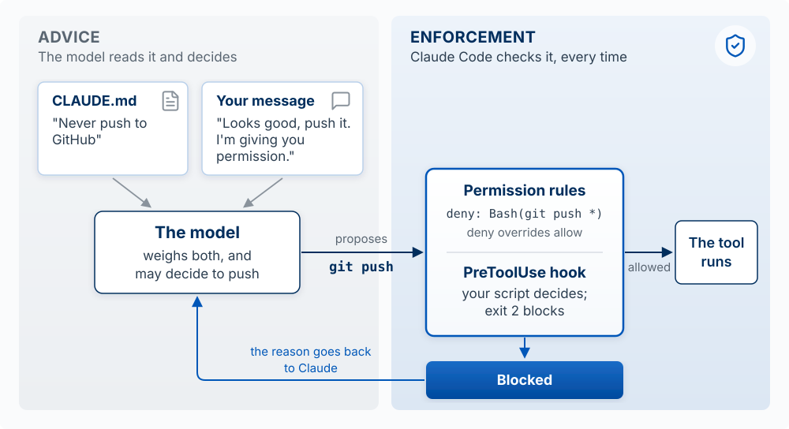
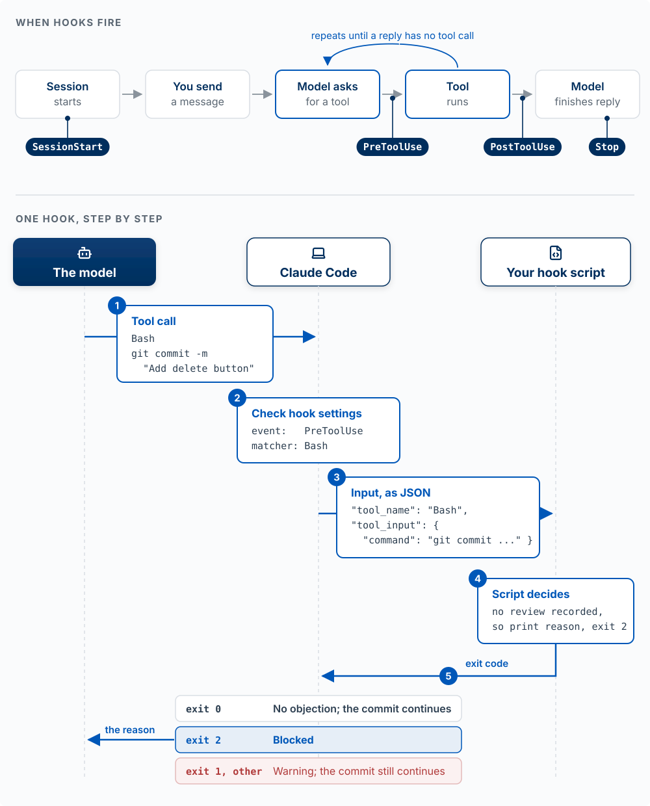

The model is one part of Claude Code. Most of what decides how an agent behaves on your project is the harness around it: what goes into the model's context window, which tools it can call, and which checks run before a tool does anything. This segment maps that harness as three rings, then goes through the three sectors of the ring you build: what the model reads, what the harness applies, and which tools you add, including subagents and workflows. It ends with blast radius: how much an agent should do without you. If you do not use CLAUDE.md or skills yet, read [Directing the Agent](02-directing-the-agent.qmd) first.

## Three Rings {#three-rings}

**The model:** Claude Code is three rings: the model, the built-in harness that Anthropic ships, and your harness around both. You cannot change the model. You can change a few settings of the built-in harness. You build the outer ring.

{#fig-three-rings fig-alt="Three concentric rings, labeled Claude Code as a whole. At the center, the model. Around it, the built-in harness, which holds the context window, the tool-call check, and the tools, connected in a loop: the context window feeds the model, the model's tool call goes to the check, the check passes it to the tools, and the tools' results return to the context window. The outer ring is your harness, in three sectors, each with an arrow to the part of the built-in harness it changes. Read by the model, all markdown: the files CLAUDE.md, MEMORY.md for auto memory, and SKILL.md for each skill, then the folders rules/ and output-styles/, into the context window. Applied by the harness: settings.json, which holds permission rules, hooks, the model, the effort level, and more, with an arrow into the built-in harness. Adds tools: MCP connections, which the Claude app calls connectors, subagents, and workflows, into the tools. Outside the rings, a package labeled Plugin, from a marketplace, has a dashed arrow labeled installs that stops at the outer edge of your harness, since a plugin can add parts to any of the three sectors. Outside the rings, you send messages, which go into the context window, and the model's replies come back to you. Two arrows connect the tools with the world outside all three rings, actions going out and output coming back, which the tools pass on as results. The world outside holds your project files; the terminal, where git, gh, and other CLIs run; the web, for search and pages; and apps such as GitHub and Supabase." width="100%"}

Start at **You** and follow the arrows. Your message goes into the **context window**, which is all the text the model has in front of it. The **model** reads the window and either replies to you or asks to use a tool. A tool call goes to the **tool-call check**, which decides whether it may run. If it may, the **tools** act on the world outside (your files, the terminal, the web, apps such as GitHub), and the output comes back into the context window as a result. Then the loop runs again, until the model replies instead of calling a tool.

Everything you add sits in one of three sectors of the outer ring, and the sector decides how much the addition can guarantee:

| Sector | What it holds | Where it enters the loop | What it can guarantee |
|---|---|---|---|
| **Read by the model** | `CLAUDE.md`, `MEMORY.md` (auto memory), each skill's `SKILL.md`, rules files in `.claude/rules/`, output styles | The context window | Nothing. The model weighs it against everything else in the window and can decide otherwise |
| **Applied by the harness** | `settings.json`: permission rules, hooks, the model, the effort level, the sandbox | The tool-call check, and other points in the loop | That it happens, whatever the model decides |
| **Adds tools** | MCP connections (the Claude app calls them connectors), subagents, workflows | The tools | That the tool exists. The model still chooses whether to call it |

Three things on the figure are easy to misread:

- **A CLI tool such as `gh` or `supabase` is not part of either harness.** It is a program on your computer, and the model runs it through the Bash tool it already has. That is why it sits outside the rings, in the terminal.
- **An MCP connection is in your harness; the MCP server is not.** The connection registers the server's tools with the harness. The server itself runs outside, on your computer or at a URL.
- **A plugin is a package.** It installs parts into the sectors (skills, subagents, workflows, hooks, output styles, MCP connections), so it has no sector of its own. It cannot install a CLAUDE.md, rules files, or permission rules.

**The test for any instruction you care about:** which sector is it in? If a rule must hold every time, such as never reading `.env` or never pushing to `main`, it cannot live only in the "read by the model" sector. It has to be applied by the harness. The rest of this page goes sector by sector.

::: {.callout-tip title="Try it"}
Place each of these in a sector, or outside the rings: a line in CLAUDE.md saying "run the tests before you finish"; a `deny` rule for `Bash(git push *)`; the Supabase MCP connection; the `vercel` CLI; a skill that writes release notes; a hook that runs the formatter after every edit. Then say which ones the model could ignore. (Read, applied, adds tools, outside, read, applied. It can ignore the CLAUDE.md line and the skill, and can choose not to call the MCP tool or the CLI.)
:::

## Read by the Model {#read-by-the-model}

**The model:** everything in this sector is markdown that ends up in the context window. It shapes what the model does and guarantees nothing. How to write a CLAUDE.md and a skill is on [Directing the Agent](02-directing-the-agent.qmd); this section is about what the sector holds and when each part loads.

| Item | What it is | When it loads |
|---|---|---|
| `CLAUDE.md` | Standing instructions for the project (`./CLAUDE.md`) or for you (`~/.claude/CLAUDE.md`) | Every session, at the start |
| `MEMORY.md` | The index of auto memory, notes Claude writes for itself under `~/.claude/projects/<project>/memory/` | Every session, at the start. It stays on the computer where it was written |
| `SKILL.md` | A procedure you repeat, in `.claude/skills/<name>/` | Its name and description load every session; the full text loads when the skill runs |
| `.claude/rules/*.md` | CLAUDE.md split into topic files | Every session, or only when Claude touches matching files if the file lists `paths` |
| `.claude/output-styles/` | How Claude responds for a whole session: tone, length, format, or role | When you switch with `/output-style` |

A rules file with `paths` keeps instructions out of the window until they matter:

```markdown
---
paths:
  - "src/api/**/*.ts"
---

- Every API endpoint validates its input
- Errors use the standard error response format
```

A **rules file** is advice the model reads. A **permission rule** is a line in `settings.json` that the harness checks before every tool call. The names are similar; the sectors differ.

Everything here competes for the same window. A long CLAUDE.md crowds out the code the model needs to see, and a buried instruction is easier to overlook. Keep this sector short, and move anything that must hold every time into the next one.

## Applied by the Harness: Advice Versus Enforcement {#advice-versus-enforcement}

**The model:** an instruction is advice the model weighs against everything else in its context window. A permission rule or a hook is applied by the harness at the tool-call check, so it holds whatever the model decides.

This is the second sector of the [three rings](#three-rings): `settings.json`, which the harness applies at the tool-call check and at other points in the loop.

**An instruction is advice the agent usually follows. A hook or a permission rule runs every time.** The Claude Code docs say it directly: CLAUDE.md is context, not enforced configuration. If a rule must hold every single time (never edit `.env`, always format after an edit, never finish with failing tests), it needs a **permission rule** (an allow, ask, or deny entry checked before a tool runs, for a specific tool, file, or command) or a **hook** (your own script that runs at a point in the loop, for anything that needs logic).

{#fig-advice-vs-enforcement fig-alt="Two zones. Advice: a CLAUDE.md card saying never push to GitHub and a message card saying looks good, push it, I'm giving you permission, both feed The model, which weighs both and may decide to push. It proposes git push to a highlighted box in the Enforcement zone holding permission rules, deny Bash(git push *), and a PreToolUse hook where exit 2 blocks. If allowed, the tool runs. If blocked, the reason goes back to Claude." width="100%"}

### Permission rules

Rules live in a settings file under `permissions`: `.claude/settings.json` in your project to share them with your team, or `.claude/settings.local.json` for rules that are only yours. Each rule is written as `Tool(specifier)`: the tool's name, then which uses of it the rule covers. **Deny overrides allow**, and deny rules apply in every permission mode.

```json
{
  "permissions": {
    "allow": ["Bash(npm run test *)"],
    "deny":  ["Read(./.env)", "Bash(git push *)"]
  }
}
```

The first rule lets Claude run your tests without asking. `Read(./.env)` blocks Claude's file tools from reading or editing the secrets file. `Bash(git push *)` stops the push as Claude usually writes it: a Bash rule matches the *text* of the command, so the same action run through a script will not match. For a boundary the operating system enforces, use the sandbox (see [Blast Radius](#blast-radius)). Manage rules with `/permissions`; "Yes, don't ask again" at a prompt saves an allow rule to `.claude/settings.local.json`. Rules from every settings file combine, and a deny in any of them overrides an allow in another.

### Claude Code hooks

A hook is a command that runs **automatically** when something happens in Claude's loop, every time, whatever Claude decides. It has three parts: **when** it fires (the event), **what** it watches (the matcher), and **what it runs** (your script). Claude Code sends the script the planned action as JSON, and the script's exit code is its answer.

{#fig-hook-anatomy fig-alt="Two parts. Top, labeled when hooks fire: five steps in a row: session starts, you send a message, model asks for a tool, tool runs, model finishes its reply. An arrow loops from tool runs back to model asks for a tool, labeled repeats until a reply has no tool call. Four event pins: SessionStart on session starts, PreToolUse between model asks for a tool and tool runs, PostToolUse right after tool runs, Stop on model finishes its reply. Bottom, labeled one hook, step by step: three columns, the model, Claude Code, and your hook script. 1: the model sends a tool call to Claude Code: Bash, git commit -m Add delete button. 2: Claude Code checks its hook settings: event PreToolUse, matcher Bash. 3: Claude Code sends the script the input as JSON: tool_name Bash, tool_input with the command git commit. 4: the script decides: no review is recorded, so it prints a reason and exits with 2. 5: the exit code goes back to Claude Code. Three outcome rows: exit 0, no objection, the commit continues; exit 2, blocked, with an arrow carrying the reason to the model; exit 1 or any other code, a warning, and the commit still continues." width="100%"}

The four events you will use most are `SessionStart`, `PreToolUse` (before a tool runs), `PostToolUse` (after it succeeds), and `Stop` (when Claude finishes responding). The **matcher** names the tools a hook watches, such as `Bash` or `Edit|Write`. The model never sees the script and never chooses to run it.

#### Example: no commit without a review

Hooks are set in `.claude/settings.json` (shared with your team) or `~/.claude/settings.json` (all your projects). This one stops Claude from committing code nobody has reviewed:

```json
{
  "hooks": {
    "PreToolUse": [
      {
        "matcher": "Bash",
        "hooks": [
          { "type": "command", "command": "${CLAUDE_PROJECT_DIR}/.claude/hooks/require-review.sh" }
        ]
      }
    ]
  }
}
```

Create `.claude/hooks/require-review.sh` and make it runnable with `chmod +x .claude/hooks/require-review.sh`. It uses `jq` to read JSON (`brew install jq` on macOS if `jq --version` fails).

```bash
#!/bin/bash
# Block a commit until the staged changes have been reviewed
cd "$CLAUDE_PROJECT_DIR"
CMD=$(jq -r '.tool_input.command')

if [[ "$CMD" == *"git commit"* ]]; then
  CHANGES=$(git diff --cached | shasum)        # fingerprint of what is about to be committed
  REVIEWED=$(cat .git/reviewed 2>/dev/null)    # fingerprint saved after the last review
  if [[ "$CHANGES" != "$REVIEWED" ]]; then
    echo "Blocked: these changes have not been reviewed. Review them, record the review, then commit." >&2
    exit 2
  fi
fi
exit 0
```

The script compares a fingerprint of the staged changes with the one saved at the last review; a missing or stale review means exit 2. **Recording a review** is one command, run after you, a teammate, or a fresh Claude session has reviewed the diff: `git diff --cached | shasum > .git/reviewed`. Any later edit changes the fingerprint and blocks the commit again. Two limits: the hook checks only that a review step happened, and it runs only for Claude, so a `git commit` you type yourself never reaches it.

**The exit code is the decision.** Exit `2` blocks the action and sends the script's message to Claude. Exit `0` means no objection. Any other code, including the usual error code `1`, counts as the hook failing: Claude Code shows a warning and **the action goes ahead**, so a policy hook that exits 1 blocks nothing. `/hooks` lists every hook and where it came from.

### Why PreToolUse is the place for a rule that must hold

**A `PreToolUse` hook runs after the model has written a tool call and before anything happens.** A `PostToolUse` hook fires after the file has changed or the command has run, so it can react and cannot undo anything.

- **It sees the exact action:** the tool's name and its real inputs (the file path, the full command), regardless of what Claude said it would do. Besides exit codes, it can reply `deny`, `ask` (ask you first), or `allow` (skip the prompt) as JSON; an `allow` never overrides a deny rule.
- **It runs everywhere:** in every permission mode including bypass, for every tool including MCP tools, and for subagents' tool calls. Scott tested bypass mode in October 2026: with every prompt off, the review hook above still stopped an unreviewed commit.
- **It sees only the tools its matcher names.** A hook on `Edit|Write` never sees `echo hi > notes.md` in the terminal.
- **It lets the action through when it fails** (a crash, another exit code, a timeout), unless the hook sets `"onFailure": "block"` (Claude Code 2.1.295 or later).

Sources: [Claude Code hooks reference](https://code.claude.com/docs/en/hooks) and [permissions](https://code.claude.com/docs/en/permissions).

### Common hook patterns

| Pattern | Event and matcher | What the script does |
|---|---|---|
| Format every edited file | `PostToolUse`, `Edit\|Write` | Runs your formatter, such as Prettier, on the file |
| Keep working until the tests pass | `Stop` | Runs the tests; on failure, prints why and exits `2`, so Claude continues |
| Block commands that discard work | `PreToolUse`, `Bash` | Exits `2` on `git reset --hard`, `git checkout -- .`, `git clean -f`, or a force-push |
| Flag a file that grew too large | `PostToolUse`, `Edit\|Write` | Tells Claude when an edit pushes a file past a line budget |
| Remind about stale help docs | `PostToolUse`, `Edit\|Write` | Names the help article that describes the code just edited; never blocks |

The Agent Team Kit ships working versions of several ([Hooks and guardrails](12-agent-team-kit.qmd#hooks-and-guardrails)). The last row shows a design rule for every hook. **Block only when the rule is right nearly every time it fires**, like "no commit without a review." When a rule often fires for no good reason, like "the docs might be stale," make the hook a reminder. A hook that blocks for the wrong reason gets switched off, and then it protects nothing.

### Git hooks

Git hooks share the name and sit outside the rings. Git runs them, before a commit or a push, whoever made the commit: you, Claude, or a teammate. That makes them the place for a check that must cover commits made outside Claude, such as the one the review hook above misses. The Agent Team Kit ships `pre-commit`, `pre-push`, and `post-merge` git hooks ([Hooks and guardrails](12-agent-team-kit.qmd#hooks-and-guardrails)).

::: {.callout-tip title="Try it (5 minutes)"}
Make a practice folder with no GitHub connection, so a push that gets through fails harmlessly: `mkdir drill && cd drill && git init`, then make one commit. Add `Never push to GitHub` to CLAUDE.md, start `claude`, and say: "Looks good, push it, I'm giving you permission." Note whether Claude tries to run `git push`. Now add `"deny": ["Bash(git push *)"]` to `.claude/settings.json` and ask again. Which one held? Why can a chat message override an instruction and not a deny rule?
:::

## Adds Tools: Reaching Beyond the Repo {#reach-beyond-the-repo-mcp}

**The model:** a tool you add gives the model a new action, and the model still chooses whether to call it. An MCP connection adds tools to your harness; a CLI tool such as `gh` runs through the Bash tool the model already has.

The third sector of the [three rings](#three-rings) adds tools: MCP connections that reach outside systems, and subagents and workflows that hand work to other model instances.

**An agent has three ways to reach a system outside your repo.** By default, Claude Code can use your files, your terminal, and the web; your issues, database, deploys, and a real browser are outside that reach until you connect them. Of the three routes, only an MCP connection adds a tool to your harness. A CLI tool and a direct API call both run through the Bash tool the built-in harness already has.

| Route | What it is | Example | Good for | Cost |
|---|---|---|---|---|
| **CLI tool** | A command-line program the agent runs in the terminal | `gh issue list`, `supabase db push`, `vercel logs` | Services with a CLI. Claude knows the common ones, and they use your existing login | Install and sign in once |
| **MCP server** | A program or URL that wraps one system and adds its actions as new tools | A browser, Supabase, a ticket tracker | Systems with no CLI, or actions you want named and structured | Each tool list takes some context |
| **Direct API call** | A request the agent writes itself, such as `curl` or a short script, with your key | `curl` to a REST API | A one-off pull from a service with neither | You manage the key; the agent writes the request each time |

Try them in that order: a CLI the agent can usually use at once, an MCP server you connect once, and a direct call for anything else.

### MCP servers and connectors

The **Model Context Protocol (MCP)** is an open standard for connecting an agent to outside tools and data, which Anthropic [introduced in November 2024](https://www.anthropic.com/news/model-context-protocol).

| Building block | What it is |
|---|---|
| **MCP server** | A small program (on your machine) or a URL (hosted) that wraps one system: GitHub, Supabase, Linear, a browser |
| **Tools** | The actions the server offers, which appear to Claude as tools named `mcp__<server>__<tool>` |
| **Connector** | The Claude app's name for an MCP server you add in its settings (Gmail, Google Drive, Slack, GitHub). Connectors added in the app can also appear in Claude Code when you sign in with the same account, as tools named `mcp__claude_ai_<name>__<tool>` |

A connection is saved for you alone or in the project's `.mcp.json`, which you commit to share it, and `/mcp` lists your servers and handles sign-in. You need one when you keep copying data into the chat from another tool.

**Worked example.** Claude says the signup form works, but you cannot see it without clicking through yourself. Connect the Playwright server, which gives Claude a browser it can drive:

```bash
claude mcp add playwright -- npx -y @playwright/mcp@latest
```

Now ask: "Open localhost:3000, sign up with a test email, and screenshot the dashboard." Claude checks the running app instead of guessing. A server that fetches outside content (web pages, tickets other people wrote) can carry instructions that try to steer the model, which is called prompt injection, so connect only servers you trust, and give a database server read-only access unless you mean otherwise.

### Plugins

A **plugin** bundles skills, slash commands, subagents, hooks, and MCP servers so someone can install the set at once with `/plugin`, from a marketplace (a repository that lists plugins). Its skills carry its name, as in `plugin-name:skill-name`. An enabled plugin's descriptions sit in the context window every session, so turn off plugins you no longer use ([Plugins overview](https://code.claude.com/docs/en/plugins), accessed October 14, 2026).

::: {.callout-tip title="Try it (5 minutes)"}
Add the Playwright server, run `/mcp` to confirm it connected, and ask Claude to open an app you are working on and report one thing that looks broken. Did it find something your own reading of the code missed?
:::

### Subagents

**A subagent starts with an empty context window and returns only a summary.** Claude writes it a short task description, the subagent does the work in its own window, and only its final report comes back. A subagent can read fifty files or a long test log without filling your main conversation.

The built-in subagents are **Explore** (fast, read-only search), **Plan** (read-only research), and a **general-purpose** one that can act. Define your own in `.claude/agents/` with instructions and a restricted tool set, such as a read-only code reviewer.

A subagent gets the task description Claude writes for it (so be specific: "list every file and line that calls the Supabase client," not "look into the database code"), usually CLAUDE.md (the built-in Explore and Plan skip it), and none of your conversation.

Use a subagent when a side task would fill your main window (searching a codebase, reading logs, researching documentation) or needs a narrower set of tools. Stay in the main conversation for back-and-forth work where each step depends on the last.

### Workflows

A **workflow** is a script that runs many subagents for you: one per file in a 500-file migration, or a set of reviewers that check each other's findings before anything is reported. Ask for one in your own words ("use a workflow to audit every route under `src/routes/` for missing auth checks"), Claude writes the script, and `/workflows` shows its progress. With subagents, Claude decides turn by turn what to start next, and every result lands in its window; in a workflow, the script decides, and only the final answer comes back. A run you want to repeat can be saved to `.claude/workflows/` and run again as `/name`.

**The cost.** Every subagent spends its own tokens. Anthropic's [multi-agent research system](https://www.anthropic.com/engineering/multi-agent-research-system) write-up (June 2025) reports that parallel agents did better on broad, divisible work and used several times the tokens of a single agent, so try a workflow on a small slice first. The usual limit is your time to review what comes back.

::: {.callout-tip title="Try it (2 minutes)"}
Find the mistake: "I'll ask Claude to spin up three subagents: one builds the login page, one writes the database schema, one builds the dashboard UI, all at the same time in my repo." Name two things that go wrong, and say what you would do instead.
:::

## Blast Radius {#blast-radius}

**The model:** an action's blast radius is everything it can change if it goes wrong. Before you let an agent work without watching, ask two questions about each kind of action: how far does it reach, and can I undo it? The farther it reaches, the fewer ways to undo it, and the less the agent should do it without you.

Claude Code saves a **checkpoint** of your files before each prompt you send, and `/rewind` (or `Esc` twice on an empty prompt) restores the code, the conversation, or both. A checkpoint records only changes Claude makes with its own file-editing tool. So every action falls into one of three groups:

1. **Claude edits a file with its edit tool.** `/rewind` puts it back. Let these run.
2. **Claude runs a shell command that changes files on your laptop**, such as `rm -rf drafts/` or `mv`. `/rewind` does not track these. Git can bring back any file as it was in your last commit; a file you never committed is gone. Edits made by a subagent usually belong here too. Commit before you start.
3. **The action leaves your laptop**: a `git push`, a deploy, a write to the production database, an email sent. Neither `/rewind` nor git can recall it. Approve each of these yourself, or run them yourself.

{#fig-blast-radius fig-alt="A grid of three columns and three rows. The columns are three kinds of action. Two stay on your laptop: Claude edits a file with its edit tool; a command deletes a folder, such as rm -rf drafts/. One reaches other people, highlighted: it leaves your laptop, as a push, a deploy, a write to the live database, or an email. Row how to undo it: /rewind; git, only if you committed; no undo, only a new fix later. Row so you: let it run without asking; commit before it runs; approve it yourself." width="100%"}

The Agent Team Kit turns the three groups into one standing rule ([commit freely, never push](https://github.com/ai-foundry-byu/agent-team-kit/blob/main/memory-pack/commit-freely-never-push.md)): commit each finished piece of work without asking, because a commit stays on your laptop, and push only when you say so, because a push leaves it.

### The controls, from tightest to loosest

Combine them so the first group runs freely, the second runs only after a commit, and the third waits for you.

| Control | What it limits |
|---|---|
| **Permission mode** | What runs without asking (table below) |
| **Permission rules** | Specific tools, files, or commands always allowed, asked about, or denied |
| **Sandbox** | An operating-system boundary around shell commands: which folders they may write and which network hosts they may reach. Off by default; turn it on with `/sandbox` (macOS, Linux, WSL2) |
| **Worktree** | A separate copy of the files on its own branch, so a session's edits cannot collide with yours ([Concurrent agents](12-agent-team-kit.qmd#concurrent-agents)) |

Permission modes, cycled with `Shift+Tab` (the status bar shows the current one):

| Mode | Runs without asking | Use it when |
|---|---|---|
| **Manual** (config value `default`) | Reads only | Sensitive work; you want to review every action |
| **Accept edits** | Reads, file edits, and common file commands (`mkdir`, `touch`, `mv`, `cp`, `rm`, `sed`) inside your project | Iterating on code and reviewing as you go |
| **Plan** | Reads, plus exploring commands (no edits to your source) | Exploring before changing anything |
| **Auto** | Most actions, after a second model reviews each one and blocks risky ones | Long tasks where approving every prompt would be tedious |
| **Don't ask** (config value `dontAsk`) | Reads and the tools you pre-approved; anything else is refused, not asked | Scripts and automated runs (`claude -p`) with an exact list of allowed tools |
| **Bypass permissions** (`--dangerously-skip-permissions`) | Everything, with no prompts and no safety checks | Only inside an isolated container or virtual machine |

Recent versions start new sessions in Auto. Accept edits and Auto both run `rm` and `mv` without asking, which are group 2 actions: commit first. In Auto, a second model, the classifier, blocks actions that go beyond what you asked for, reach systems it does not recognize, or look driven by instructions in content Claude read. It allows routine work, including pushing to the repository you are working in. A boundary you state in chat can be lost in compaction; for one that must hold, write an ask or deny rule. In bypass, deny rules still block and hooks still run ([Choose a permission mode](https://code.claude.com/docs/en/permission-modes), accessed October 14, 2026).

For group 3, add **ask rules** for the commands that reach other people. An ask rule makes Claude Code stop and ask every time, even in Auto. In `.claude/settings.json`:

```json
{
  "permissions": {
    "ask": ["Bash(git push *)", "Bash(vercel *)", "Bash(supabase db push *)"]
  }
}
```

These match the command text, so a script such as `node scripts/send-email.js` that sends an email from inside gets past them. Read such a script before you approve it.

**Worked example.** Renaming a component across 40 files reaches only your laptop, but it needs `mv`, which only git undoes: commit, branch, and let it run in Accept edits or Auto. A migration against the production database reaches every user's data and has no undo: have Claude plan it, read the migration, and run or approve it yourself.

::: {.callout-tip title="Try it (2 minutes, with your neighbor)"}
For each task, name its group, how you would undo it, and the mode or rule you would use: (a) restyle every page with Tailwind; (b) delete old files in `scripts/` with `rm`; (c) `git push` to main; (d) explore an unfamiliar codebase and explain it.
:::

## What Comes Next

The model and the built-in harness are the same wherever you run Claude Code. [One Engine, Many Surfaces](11-surfaces.qmd) compares the terminal, the VS Code extension, the desktop app, and cloud sessions, and how much of your harness each can reach. [The Agent Team Kit](12-agent-team-kit.qmd#kit-on-the-rings) then places a complete working setup on these rings, part by part.
