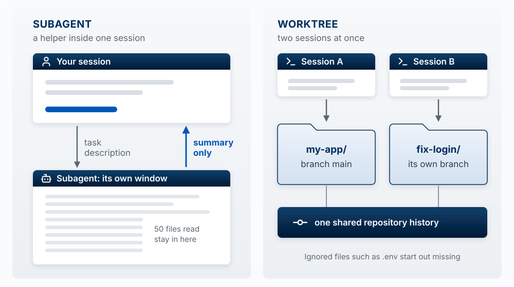

The model is one part of Claude Code. Most of what decides how an agent behaves on your project is the harness around it: what goes into the model's context window, which tools it can call, and which checks run before a tool does anything. This segment maps that harness, then goes through the parts you control: what the model reads, what the harness applies, which tools you add, how far an action can reach, and how to split work across agents. The [Agent Team Kit](12-agent-team-kit.qmd) is built out of these parts, so it is easier to follow once the map is clear. If you do not use CLAUDE.md or skills yet, read [Directing the Agent](02-directing-the-agent.qmd) first.

## Three Rings {#three-rings}

**Claude Code is three rings: the model, the built-in harness that Anthropic ships, and your harness around both.** You cannot change the model. You can change a few settings of the built-in harness. You build the outer ring.

{#fig-three-rings fig-alt="Three concentric rings, labeled Claude Code as a whole. At the center, the model. Around it, the built-in harness, which holds the context window, the tool-call check, and the tools, connected in a loop: the context window feeds the model, the model's tool call goes to the check, the check passes it to the tools, and the tools' results return to the context window. The outer ring is your harness, in three sectors, each with an arrow to the part of the built-in harness it changes. Read by the model, all markdown: the files CLAUDE.md, MEMORY.md for auto memory, and SKILL.md for each skill, then the folders rules/ and output-styles/, into the context window. Applied by the harness: settings.json, which holds permission rules, hooks, the model, the effort level, and more, with an arrow into the built-in harness. Adds tools: MCP connections, which the Claude app calls connectors, subagents, and workflows, into the tools. Outside the rings, a package labeled Plugin, from a marketplace, has a dashed arrow labeled installs that stops at the outer edge of your harness, since a plugin can add parts to any of the three sectors. Outside the rings, you send messages, which go into the context window, and the model's replies come back to you. Two arrows connect the tools with the world outside all three rings, actions going out and output coming back, which the tools pass on as results. The world outside holds your project files; the terminal, where git, gh, and other CLIs run; the web, for search and pages; and apps such as GitHub and Supabase." width="100%"}

Start at **You** and follow the arrows. Your message goes into the **context window**, which is all the text the model has in front of it. The **model** reads the window and either replies to you or asks to use a tool. A tool call goes to the **tool-call check**, which decides whether it may run. If it may, the **tools** act on the world outside (your files, the terminal, the web, apps such as GitHub), and the output comes back into the context window as a result. Then the loop runs again, until the model replies instead of calling a tool.

Everything you add sits in one of three sectors of the outer ring, and the sector decides how much the addition can guarantee:

| Sector | What it holds | Where it enters the loop | What it can guarantee |
|---|---|---|---|
| **Read by the model** | `CLAUDE.md`, `MEMORY.md` (auto memory), each skill's `SKILL.md`, rules files in `.claude/rules/`, output styles | The context window | Nothing. The model weighs it against everything else in the window and can decide otherwise |
| **Applied by the harness** | `settings.json`: permission rules, hooks, the model, the effort level, the sandbox | The tool-call check, and other points in the loop | That it happens, whatever the model decides |
| **Adds tools** | MCP connections (the Claude app calls them connectors), subagents, workflows | The tools | That the tool exists. The model still chooses whether to call it |

Three things on the figure are easy to misread:

- **A CLI tool such as `gh` or `supabase` is not part of either harness.** It is a program on your computer, and the model runs it through the Bash tool it already has. That is why it sits outside the rings, in the terminal.
- **An MCP connection is in your harness; the MCP server is not.** The connection registers the server's tools with the harness. The server itself runs outside, on your computer or at a URL.
- **A plugin is a package.** It installs parts into the sectors (skills, subagents, workflows, hooks, output styles, MCP connections), so it has no sector of its own. It cannot install a CLAUDE.md, rules files, or permission rules.

**The test for any instruction you care about:** which sector is it in? If a rule must hold every time, such as never reading `.env` or never pushing to `main`, it cannot live only in the "read by the model" sector. It has to be applied by the harness. The rest of this page goes sector by sector.

::: {.callout-tip title="Try it"}
Place each of these in a sector, or outside the rings: a line in CLAUDE.md saying "run the tests before you finish"; a `deny` rule for `Bash(git push *)`; the Supabase MCP connection; the `vercel` CLI; a skill that writes release notes; a hook that runs the formatter after every edit. Then say which ones the model could ignore. (Read, applied, adds tools, outside, read, applied. It can ignore the CLAUDE.md line and the skill, and can choose not to call the MCP tool or the CLI.)
:::

## Read by the Model {#read-by-the-model}

**Everything in this sector is markdown that ends up in the context window.** It shapes what the model does and guarantees nothing.

| Item | What it is | When it loads |
|---|---|---|
| `CLAUDE.md` | Standing instructions for the project (`./CLAUDE.md`) or for you (`~/.claude/CLAUDE.md`) | Every session, at the start |
| `MEMORY.md` | The index of auto memory, notes Claude writes for itself under `~/.claude/projects/<project>/memory/` | Every session, at the start. It stays on the computer where it was written |
| `SKILL.md` | A procedure you repeat, in `.claude/skills/<name>/` | Its name and description load every session; the full text loads when the skill runs |
| `.claude/rules/*.md` | CLAUDE.md split into topic files | Every session, or only when Claude touches matching files if the file lists `paths` |
| `.claude/output-styles/` | How Claude responds for a whole session: tone, length, format, or role | When you switch with `/output-style` |

A rules file with `paths` keeps instructions out of the window until they matter:

```markdown
---
paths:
  - "src/api/**/*.ts"
---

- Every API endpoint validates its input
- Errors use the standard error response format
```

A **rules file** is different from a **permission rule**. A rules file is advice the model reads. A permission rule is a line in `settings.json` that the harness checks before every tool call. The names are similar; the sectors are not.

Because everything here competes for the same window, more is not better. A long CLAUDE.md pushes out the code the model needs to see, and an instruction buried in it is easier to overlook. Keep this sector short, and move anything that must hold every time into the next one.

## Applied by the Harness: Advice Versus Enforcement {#advice-versus-enforcement}

This is the second sector of the [three rings](#three-rings): `settings.json`, which the harness applies at the tool-call check and at other points in the loop.

**An instruction is advice the agent usually follows. A hook or a permission rule runs every time.** The Claude Code docs say it directly: CLAUDE.md is context, not enforced configuration. If a rule must hold every single time (never edit `.env`, always format after an edit, never finish with failing tests), it cannot live only in CLAUDE.md. It needs one of two enforcement mechanisms:

| Mechanism | What it is | Good for |
|---|---|---|
| **Permission rule** | An allow, ask, or deny entry in a settings file, checked before a tool runs | Blocking or pre-approving a specific tool, file, or command |
| **Hook** | Your own script that Claude Code runs automatically at a point in the loop | Anything that needs logic: check the branch, run the formatter, run the tests |

{#fig-advice-vs-enforcement fig-alt="Two zones. Advice: a CLAUDE.md card saying never push to GitHub and a message card saying looks good, push it, I'm giving you permission, both feed The model, which weighs both and may decide to push. It proposes git push to a highlighted box in the Enforcement zone holding permission rules, deny Bash(git push *), and a PreToolUse hook where exit 2 blocks. If allowed, the tool runs. If blocked, the reason goes back to Claude." width="100%"}

### Permission rules

Rules live in a settings file under `permissions`: `.claude/settings.json` in your project to share them with your team, or `.claude/settings.local.json` for rules that are only yours. Each rule is written as `Tool(specifier)`: the tool's name, then which uses of it the rule covers. **Deny overrides allow**, and deny rules apply in every permission mode.

```json
{
  "permissions": {
    "allow": ["Bash(npm run test *)"],
    "deny":  ["Read(./.env)", "Bash(git push *)"]
  }
}
```

The first rule lets Claude run your tests without asking. `Read(./.env)` blocks Claude's file tools from reading the secrets file, and a Read deny also blocks editing it. `Bash(git push *)` stops the push command as Claude usually writes it.

One limit to know: a Bash rule matches the *text* of the command, so the same action written another way (through a script, say) will not match it. For a boundary the operating system enforces, use the sandbox (see [Blast Radius](#blast-radius)). Manage rules with `/permissions`. Choosing "Yes, don't ask again" at a prompt saves an allow rule to `.claude/settings.local.json`.

When two settings files disagree, the more specific one wins: local project settings (`.claude/settings.local.json`) over shared project settings (`.claude/settings.json`), over your user settings (`~/.claude/settings.json`). An organization's managed settings, if any, win over all three. Permission rules from all the files are combined, and a deny in any of them overrides an allow in another.

### Claude Code hooks

A hook is a command that runs **automatically** when something happens, every time, whatever Claude decides. Two different things are both called hooks:

- **Claude Code hooks** fire on Claude's own actions: before or after it uses a tool, when it finishes a response, when a session starts.
- **Git hooks** fire on Git's actions: before a commit, before a push. They run whether the commit came from you, from Claude, or from a teammate.

A Claude Code hook has three parts: **when** it fires (the event), **what** it watches (the matcher), and **what it runs** (your script). Claude Code sends the script the planned action as JSON, and the script's exit code is its answer.

{#fig-hook-anatomy fig-alt="Two parts. Top, labeled when hooks fire: five steps in a row: session starts, you send a message, model asks for a tool, tool runs, model finishes its reply. An arrow loops from tool runs back to model asks for a tool, labeled repeats until a reply has no tool call. Four event pins: SessionStart on session starts, PreToolUse between model asks for a tool and tool runs, PostToolUse right after tool runs, Stop on model finishes its reply. Bottom, labeled one hook, step by step: three columns, the model, Claude Code, and your hook script. 1: the model sends a tool call to Claude Code: Bash, git commit -m Add delete button. 2: Claude Code checks its hook settings: event PreToolUse, matcher Bash. 3: Claude Code sends the script the input as JSON: tool_name Bash, tool_input with the command git commit. 4: the script decides: no review is recorded, so it prints a reason and exits with 2. 5: the exit code goes back to Claude Code. Three outcome rows: exit 0, no objection, the commit continues; exit 2, blocked, with an arrow carrying the reason to the model; exit 1 or any other code, a warning, and the commit still continues." width="100%"}

The events you will use most:

| Event | When it fires | Typical use |
|---|---|---|
| `PreToolUse` | Before Claude uses a tool (edit a file, run a command) | Block something dangerous |
| `PostToolUse` | After a tool succeeds | Format or check a file Claude just edited |
| `Stop` | When Claude finishes responding | Make Claude keep going until the tests pass |
| `SessionStart` | When a session starts | Load facts like the current branch |

The **matcher** names the tools a hook watches: `Bash` (every terminal command) or `Edit|Write` (file edits and new files). The **hook script** is a short program, usually Bash or Python, that Claude Code runs outside the conversation. The model never sees it and never chooses to run it.

#### Example: no commit without a review

Hooks are set in `.claude/settings.json` (commit it to share with your team) or `~/.claude/settings.json` (all your projects). This one stops Claude from committing code nobody has reviewed:

```json
{
  "hooks": {
    "PreToolUse": [
      {
        "matcher": "Bash",
        "hooks": [
          { "type": "command", "command": "${CLAUDE_PROJECT_DIR}/.claude/hooks/require-review.sh" }
        ]
      }
    ]
  }
}
```

Create `.claude/hooks/require-review.sh` and make it runnable with `chmod +x .claude/hooks/require-review.sh`. It uses `jq` to read JSON (`brew install jq` on macOS if `jq --version` fails).

```bash
#!/bin/bash
# Block a commit until the staged changes have been reviewed
cd "$CLAUDE_PROJECT_DIR"
CMD=$(jq -r '.tool_input.command')

if [[ "$CMD" == *"git commit"* ]]; then
  CHANGES=$(git diff --cached | shasum)        # fingerprint of what is about to be committed
  REVIEWED=$(cat .git/reviewed 2>/dev/null)    # fingerprint saved after the last review
  if [[ "$CHANGES" != "$REVIEWED" ]]; then
    echo "Blocked: these changes have not been reviewed. Review them, record the review, then commit." >&2
    exit 2
  fi
fi
exit 0
```

The script reads the command Claude is about to run, ignores everything except commits, takes a fingerprint of the staged changes, and compares it with the fingerprint saved at the last review. No review, or code changed since the review, means exit 2: blocked, with the reason passed to Claude.

**Recording a review** is one command, run after the review is done: `git diff --cached | shasum > .git/reviewed`. The review can be you reading the diff, a teammate, or Claude in a fresh session asked to review the staged changes. Because the record is a fingerprint of the exact code, any edit after the review blocks the commit again. The file lives inside `.git/`, so it is never committed.

Two limits. The hook checks that a review step happened, not that the review was any good. And it runs only for Claude: when you type `git commit` in your own terminal, no Claude Code hook sees it. A git hook covers that case.

**The exit code is the decision.** Exit `2` blocks the action, and the message the script prints goes to Claude so it can adjust. Exit `0` means no objection. Any other exit code, including the usual error code `1`, is treated as the hook itself failing: Claude Code shows a warning and **the action goes ahead.** A policy hook that exits 1 blocks nothing.

Type `/hooks` to see every hook that is set up and where it came from.

### PreToolUse up close

**A `PreToolUse` hook runs after the model has written a tool call and before anything happens.** It is the last point where an action can be stopped. By the time `PostToolUse` fires, the file has changed or the command has run, so a `PostToolUse` hook can react (format the file, report a problem) but cannot undo anything.

.](images/diagrams/ch02-pretooluse.svg){#fig-pretooluse fig-alt="One tool call as five steps from left to right. In a region labeled nothing has happened yet: the model asks to commit, git commit; the PreToolUse hook, highlighted, your script decides; the permission rules, deny, ask, allow. In a region labeled already happened: the tool runs, commit is made; the PostToolUse hook, can react, cannot undo. The PreToolUse step expands into a panel. What it sees: the exact command as JSON, tool_name Bash and tool_input with the command git commit, before anything has run. What it can answer: exit 0, continue to permission rules; exit 2 or deny, blocked, reason goes to the model, highlighted; ask, ask you before it runs; allow, skip the prompt, deny rules win. Two notes below: runs in every permission mode, even bypass; sees only the tools its matcher names." width="100%"}

What makes it the right place for a rule that must hold:

- **It sees the exact action:** the tool's name and its real inputs (the file path, the full command, the text about to be written). It judges what is about to happen, regardless of what Claude said it would do.
- **It has four answers.** Exit `0` passes the call on to your permission rules. Exit `2` blocks it. A script can instead print a small JSON reply: `deny` blocks, `ask` makes Claude Code ask you first, and `allow` skips the prompt. A hook can also rewrite the call before it runs, for example to add a safety flag.
- **A block always wins.** A hook's `allow` cannot override a deny rule in your settings, and an ask rule still asks. In practice a hook can make Claude stricter than your rules, and can make it more permissive only by skipping prompts.
- **It runs everywhere:** in every permission mode including bypass, for every tool (file reads, terminal commands, web fetches, MCP tools), and for tool calls made by subagents. Scott tested bypass mode in October 2026: with every permission prompt off, a hook that exits `2` stopped a file write, and the review hook above stopped an unreviewed commit.

Two limits:

- **It sees only the tools its matcher names.** A hook with matcher `Edit|Write` never sees a terminal command that changes the same file, such as `echo hi > notes.md`. Match every tool that can do the thing you want to stop.
- **It lets the action through when it fails.** If the script crashes, exits with a code other than `0` or `2`, or times out, the action goes ahead. A hook can be set to block on failure instead with `"onFailure": "block"` in its settings (Claude Code 2.1.295 or later).

Sources: [Claude Code hooks reference](https://code.claude.com/docs/en/hooks) and [permissions](https://code.claude.com/docs/en/permissions).

### Common hook patterns

**Protect your secrets file** (`PreToolUse`, matcher `Edit|Write`): if the file path is `.env`, exit `2`. A deny rule does the same job with no script.

**Format every file Claude edits** (`PostToolUse`, matcher `Edit|Write`): run your formatter, such as Prettier, on the file.

**Keep Claude working until the tests pass** (`Stop`): run the tests; if they fail, print why and exit `2`, and Claude continues instead of stopping.

**Block commits to main** (`PreToolUse`, matcher `Bash`): if the command is a `git commit` and the current branch is `main`, exit `2`.

**Block git commands that throw away uncommitted work** (`PreToolUse`, matcher `Bash`). `git reset --hard`, `git checkout -- .`, and `git clean -f` act on every file in the folder. With two sessions in one folder, one session can erase an hour of the other's uncommitted work, with no commit to recover it from.

```bash
#!/bin/bash
# Block git commands that discard uncommitted work or rewrite pushed history
CMD=$(jq -r '.tool_input.command')
if echo "$CMD" | grep -Eq 'git (reset --hard|checkout -- \.|clean -[a-z]*f)|git push.* (--force|-f)( |$)'; then
  echo "Blocked: this command discards uncommitted work or rewrites pushed history. Commit first, or ask the user." >&2
  exit 2
fi
exit 0
```

The Agent Team Kit's [`bash-guard`](https://github.com/ai-foundry-byu/agent-team-kit/blob/main/hooks/scripts/bash-guard.mjs) does this and more, including blocking `git add -A` so one session cannot commit another session's half-finished files; the reasoning is in its [hooks reference](https://github.com/ai-foundry-byu/agent-team-kit/blob/main/docs/HOOKS.md). Like a Bash permission rule, it matches the text of the command, so it catches the usual ways of writing these commands, not every possible one.

**Flag a file that has grown too large** (`PostToolUse`, matcher `Edit|Write`). Agents tend to add to an existing file instead of splitting it, so files in an agent-built app grow to thousands of lines. The kit's [file-size check](https://github.com/ai-foundry-byu/agent-team-kit/blob/main/hooks/scripts/file-size-budget.mjs) caps new files at 800 lines by default, lets files already over the cap shrink but never grow, and tells Claude as soon as an edit goes over. Treat a file over the cap as a reason to check whether it still does one job ([why the guard works this way](https://github.com/ai-foundry-byu/agent-team-kit/blob/main/memory-pack/arch-guards-as-alarms.md)).

**Remind Claude to update the help docs** (`PostToolUse`, matcher `Edit|Write`). Map each help article to the code it describes; when Claude edits that code, the hook names the article that may now be out of date. It never blocks, because most code changes do not make the article wrong.

That last point is a design rule for every hook. **Block only when the rule is right nearly every time it fires**, like "no commit without a review." When a rule often fires for no good reason, like "the docs might be stale," make the hook a reminder. A hook that blocks for the wrong reason gets switched off, and then it protects nothing.

### Git hooks

For checks that must run on every commit from anyone, use a git hook. In JavaScript projects, Husky is the usual way to manage them: `npm install -D husky` and `npx husky init` create a `.husky/` folder, and the commands in `.husky/pre-commit` run before every commit:

```bash
npm run lint
npm run type-check
npm test
```

Any non-zero exit blocks the commit. The Agent Team Kit ships its own [`pre-commit`, `pre-push`, and `post-merge` git hooks](https://github.com/ai-foundry-byu/agent-team-kit/tree/main/hooks/githooks); its pre-push gate runs the typecheck and tests before anything leaves your laptop.

::: {.callout-tip title="Try it (5 minutes)"}
Make a practice folder with no GitHub connection, so a push that gets through fails harmlessly: `mkdir drill && cd drill && git init`, then make one commit. Add `Never push to GitHub` to CLAUDE.md, start `claude`, and say: "Looks good, push it, I'm giving you permission." Note whether Claude tries to run `git push`. Now add `"deny": ["Bash(git push *)"]` to `.claude/settings.json` and ask again. Which one held? Why can a chat message override an instruction and not a deny rule?
:::

## Adds Tools: Reaching Beyond the Repo {#reach-beyond-the-repo-mcp}

The third sector of the [three rings](#three-rings) adds tools. Of the three routes below, only an MCP connection adds a tool to your harness. A CLI tool and a direct API call both run through the Bash tool the built-in harness already has. Subagents and workflows also add tools; they are covered under [Delegation](#delegation-and-parallel-work).

**An agent has three ways to reach a system outside your repo.** By default, Claude Code can use your files, your terminal, and the web. Your GitHub issues, your database, your deploys, your tickets, and a real browser are outside that reach until you connect them.

| Route | What it is | Example | Good for | Cost |
|---|---|---|---|---|
| **CLI tool** | A command-line program the agent runs in the terminal | `gh issue list`, `supabase db push`, `vercel logs` | Services with a command-line tool. Claude already knows the common ones, and they use the login you already have | Each tool is installed and signed in once |
| **MCP server** | A program or URL that wraps one system and adds its actions to the agent as new tools | A browser server, a Supabase server, a ticket tracker | Systems with no command-line tool, or actions you want named and structured | Each server's tool list takes some context |
| **Direct API call** | A request the agent writes itself, such as `curl` or a short script, sent with your key | `curl` to a REST API | A one-off pull from a service with neither of the above | You manage the key, and the agent writes the request each time |

Try them in that order. If the service has a CLI, the agent can usually use it at once. If it has an MCP server, connect it. A direct API call works for almost anything, at the cost of handling a key.

### MCP servers and connectors

The **Model Context Protocol (MCP)** is an open standard for connecting an agent to outside tools and data, which Anthropic [introduced in November 2024](https://www.anthropic.com/news/model-context-protocol).

| Building block | What it is |
|---|---|
| **MCP server** | A small program (on your machine) or a URL (hosted) that wraps one system: GitHub, Supabase, Linear, a browser |
| **Tools** | The actions the server offers, which appear to Claude as tools named `mcp__<server>__<tool>` |
| **Scope** | Where the connection is saved: just you, or the project's `.mcp.json`, which you commit to share with your team |
| **`/mcp`** | Lists your servers and their status, and handles sign-in |
| **Connector** | The Claude app's name for an MCP server you add in its settings (Gmail, Google Drive, Slack, GitHub). Connectors added in the app can also appear in Claude Code when you sign in with the same account, as tools named `mcp__claude_ai_<name>__<tool>` |

A connector and an MCP server are the same thing under two names.

A good signal that you need one: you keep copying data into the chat from another tool. Connect the tool, and Claude reads it directly.

**Worked example.** Claude says the signup form works, but you cannot see it without clicking through yourself. Connect the Playwright server, which gives Claude a browser it can drive:

```bash
claude mcp add playwright -- npx -y @playwright/mcp@latest
```

Now ask: "Open localhost:3000, sign up with a test email, and screenshot the dashboard." Claude checks the running app instead of guessing. Supabase publishes an MCP server too; give it read-only access unless you mean otherwise, because what it does there cannot be rewound.

Two costs. Each server's tool list takes some context. And a server that fetches outside content (web pages, tickets other people wrote) can carry instructions that try to steer the model, which is called prompt injection. Connect only servers you trust.

### Plugins: a package, not a route

A **plugin** bundles skills, slash commands, subagents, hooks, and MCP servers so someone can install the set at once with `/plugin`, from a marketplace (a repository that lists plugins). It is a way to share building blocks. If a plugin reaches an outside system, it does so through an MCP server, a CLI tool, or an API call inside it. Skills from a plugin carry its name, as in `plugin-name:skill-name`. An enabled plugin's skill and agent descriptions sit in Claude's context in every session, even when nothing from it runs, so turn off plugins you no longer use ([Plugins overview](https://code.claude.com/docs/en/plugins), accessed October 14, 2026).

::: {.callout-tip title="Try it (5 minutes)"}
Add the Playwright server, run `/mcp` to confirm it connected, and ask Claude to open an app you are working on and report one thing that looks broken. Did it find something your own reading of the code missed?
:::

## Delegation and Parallel Work {#delegation-and-parallel-work}

**A subagent starts with an empty context window and returns a summary. Parallel sessions need separate copies of the files. Both cost tokens and your attention.**

{#fig-subagent-vs-worktree fig-alt="Two panels. Subagent, a helper inside one session: Your session sends a task description down to a subagent window full of lines labeled 50 files read stay in here; a highlighted arrow labeled summary only returns one line to your session. Worktree, two sessions at once: Session A works in the my-app folder on branch main, Session B in a fix-login folder on its own branch; both folders sit on one shared repository history. A note: ignored files such as .env start out missing." width="100%"}

### Subagents

Each subagent works in its own context window and does not see your conversation. Claude writes it a short task description, the subagent does the work, and only its final summary comes back. That is the point: a subagent can read fifty files or a long test log without filling your main conversation. It also means a subagent knows only what it was told.

Claude Code has built-in subagents: **Explore** (fast, read-only search), **Plan** (read-only research while planning), and a **general-purpose** one that can act. You can define your own in `.claude/agents/` with their own instructions and a restricted tool set, for example a read-only code reviewer.

What a subagent gets:

1. **The task description Claude writes for it**, so be specific: "Find every place we call the Supabase client and list the file and line" works better than "look into the database code."
2. **CLAUDE.md**, in most cases. The built-in Explore and Plan subagents skip it to stay fast, so do not count on a project rule reaching them.
3. **None of your conversation.** If the task depends on something you said, Claude has to put it in the task description.

Use a subagent when a side task would fill your main window (searching a codebase, reading logs, researching documentation) or needs a narrower set of tools. Stay in the main conversation for back-and-forth work where each step depends on the last.

### Workflows

A **workflow** is a script that runs many subagents for you: one per file in a 500-file migration, or a set of reviewers that check each other's findings before anything is reported. Ask for one in your own words ("use a workflow to audit every route under `src/routes/` for missing auth checks") and Claude writes the script. It runs in the background, and `/workflows` shows its progress. The difference from subagents is who holds the plan. With subagents, Claude decides turn by turn what to start next, and every result lands in its context window. In a workflow, the script decides, and only the final answer comes back. A run you want to repeat can be saved to `.claude/workflows/` and run again as `/name`. A workflow can use far more tokens than the same task done in conversation, so try it on a small slice first.

### Parallel sessions need separate copies of the files

Subagents run inside one session. To have two sessions building at once, keep in mind that two sessions editing the same folder will overwrite each other's work. The fix is a **git worktree**: a second working folder with its own files and branch, sharing the same repository history.

```bash
claude --worktree fix-login     # a second, isolated session on branch worktree-fix-login
```

This creates `.claude/worktrees/fix-login/`. Two things surprise people: a worktree is a fresh checkout, so gitignored files like `.env` are missing until you copy them in (a `.worktreeinclude` file can do it automatically), and it branches from your main branch on GitHub, not from unpushed work on your laptop. The desktop app offers a worktree option when you start a session.

There are two ways to run parallel sessions: one shared folder, where you keep sessions apart by giving each a different part of the app, or a worktree per session, where git keeps them apart and you merge each branch back. The first fits when you are at the keyboard watching each session; the second fits when you start several and leave them running. The Agent Team Kit supports both, covered in [The Agent Team Kit: two modes](12-agent-team-kit.qmd#two-modes).

Either way, a worktree separates files and nothing else. Every session still uses the same database, and every session that starts the app starts its own dev server. Next.js moves a second server to the next free port (3001) and prints it, but an agent that assumes `localhost:3000` will test the other session's server and report that server's errors as its own. Tell each session to use the port its own server printed, and to stop only the server it started ([run your own dev server](https://github.com/ai-foundry-byu/agent-team-kit/blob/main/memory-pack/run-your-own-dev-server.md)).

### Messaging your other sessions

Parallel sessions can pass news to each other. Tell Claude in plain words what another session should know, and it finds the session and writes the message; type `@` to pick a session from a list:

```text
Let @fix-login know the schema migration finished
Ask the session in my other terminal whether the tests passed
Tell me when the fix-login session finishes what it is working on
```

`/list-agents` (or `/peers`) shows which sessions Claude can reach: subagents in this session, your other sessions on this computer, and, over Remote Control, your sessions in the cloud and on other computers. Sessions answer to the name you give them with `/rename`, so name the ones you run in parallel.

Four facts about a message:

- **It is plain text.** It never carries the sender's conversation or files; to continue a whole conversation, use `/resume`.
- **It arrives between steps**, between tool calls, or as a new turn if the receiver was idle.
- **It has no authority.** It cannot approve a permission prompt or change settings or CLAUDE.md, and a slash command inside it does not run.
- **Where it travels.** Between sessions on one computer it goes directly. To another computer or the cloud it goes through Anthropic's servers, over Remote Control.

You choose what a session does with incoming messages in `/config`: accept them, hold each for your approval, or refuse them ([Message your other Claude Code sessions](https://code.claude.com/docs/en/cross-session-messaging), accessed October 14, 2026).

### The cost

Every subagent and parallel session spends its own tokens, and all their results come back for you to review. Anthropic's write-up of its [multi-agent research system](https://www.anthropic.com/engineering/multi-agent-research-system) (June 2025) reports that parallel agents did better on broad, divisible work and used several times the tokens of a single agent. Usually the limit is your time to review the results, more than the agent's speed.

### Task decomposition

Breaking a feature into small pieces you can check one at a time works better than asking for everything at once:

**Instead of:**
> "Build my entire app"

**Do this:**
> "Let's build the authentication system first. Start with:
> 1. Supabase client setup in /lib/supabase.ts
> 2. Auth context in /contexts/AuthContext.tsx
> 3. Login page at /login
> 4. Protected route wrapper component"

Claude does these in order in one session. Splitting them across parallel agents would not help, because each step depends on the one before.

::: {.callout-tip title="Try it (2 minutes)"}
Find the mistake: "I'll ask Claude to spin up three subagents: one builds the login page, one writes the database schema, one builds the dashboard UI, all at the same time in my repo." Name two things that go wrong, and say what you would do instead.
:::

## Blast Radius {#blast-radius}

**An action's blast radius is everything it can change if it goes wrong. Before you let an agent work without watching, ask two questions about each kind of action: how far does it reach, and can I undo it?** The farther an action reaches, the fewer ways you have to undo it, and the less you should let the agent do it without you.

Claude Code saves a **checkpoint** of your files before each prompt you send. `/rewind` (or `Esc` twice on an empty prompt) restores the code, the conversation, or both to an earlier prompt. A checkpoint records only changes Claude makes with its own file-editing tool. It does not record what a shell command does, and it cannot reach anything outside your laptop. So every action falls into one of three groups:

1. **Claude edits a file with its edit tool.** `/rewind` puts it back. Let these run.
2. **Claude runs a shell command that changes files on your laptop**, such as `rm -rf drafts/` or `mv`. `/rewind` does not track these. Git can bring back any file as it was in your last commit; a file you never committed is gone. Edits made by a subagent usually belong here too. Commit before you start.
3. **The action leaves your laptop**: a `git push`, a deploy, a write to the production database, an email sent. Neither `/rewind` nor your local git history can recall it. You can make a new change afterward, but by then a teammate may have pulled the code, users may have seen the page, and the email is in someone's inbox. Approve each of these yourself, or run them yourself.

{#fig-blast-radius fig-alt="A grid of three columns and three rows. The columns are three kinds of action. Two stay on your laptop: Claude edits a file with its edit tool; a command deletes a folder, such as rm -rf drafts/. One reaches other people, highlighted: it leaves your laptop, as a push, a deploy, a write to the live database, or an email. Row how to undo it: /rewind; git, only if you committed; no undo, only a new fix later. Row so you: let it run without asking; commit before it runs; approve it yourself." width="100%"}

The Agent Team Kit turns the three groups into one standing rule for its agents ([commit freely, never push](https://github.com/ai-foundry-byu/agent-team-kit/blob/main/memory-pack/commit-freely-never-push.md)): commit after each finished piece of work without asking, because a commit stays on your laptop and can be undone, and push only when you say so, because a push leaves your laptop. Put both halves in your CLAUDE.md.

### The controls, from tightest to loosest

Each control limits something different. Combine them so the first group runs freely, the second runs only after a commit, and the third waits for you.

| Control | What it limits |
|---|---|
| **Plan mode** | Changes to your files. Claude reads, explores, and writes a plan; it does not edit your source until you approve |
| **Permission mode** | What runs without asking (table below) |
| **Permission rules** | Specific tools, files, or commands always allowed, asked about, or denied |
| **Sandbox** | An operating-system boundary around shell commands: which folders they may write and which network hosts they may reach. Off by default; turn it on with `/sandbox` (macOS, Linux, WSL2) |
| **Worktree** | A separate copy of the files on its own branch, so a session's edits cannot collide with yours |

Permission modes, cycled with `Shift+Tab` (the status bar shows the current one):

| Mode | Runs without asking | Use it when |
|---|---|---|
| **Manual** (config value `default`) | Reads only | Sensitive work; you want to review every action |
| **Accept edits** | Reads, file edits, and common file commands (`mkdir`, `touch`, `mv`, `cp`, `rm`, `sed`) inside your project | Iterating on code and reviewing as you go |
| **Plan** | Reads, plus exploring commands (no edits to your source) | Exploring before changing anything |
| **Auto** | Most actions, after a second model reviews each one and blocks risky ones | Long tasks where approving every prompt would be tedious |
| **Don't ask** (config value `dontAsk`) | Reads and the tools you pre-approved; anything else is refused, not asked | Scripts and automated runs (`claude -p`) with an exact list of allowed tools |
| **Bypass permissions** (`--dangerously-skip-permissions`) | Everything, with no prompts and no safety checks | Only inside an isolated container or virtual machine |

Recent versions of Claude Code start new sessions in Auto; check the status bar. Accept edits and Auto both let Claude run `rm` and `mv` without asking, which are group 2 actions: commit first.

**How auto mode decides.** In Auto, a second model, the classifier, reviews each action before it runs, in place of you. It blocks actions that go beyond what you asked for, reach systems it does not recognize, or look driven by instructions in content Claude read, such as a web page or a ticket. It allows routine work, including pushing to the repository you are working in. If it blocks the same kind of action repeatedly, Claude Code goes back to asking you. A boundary you state in chat ("don't deploy until I say so") counts, but it lives only in the conversation, and compaction can summarize it away. For a boundary that must hold, write an ask or deny rule ([Choose a permission mode](https://code.claude.com/docs/en/permission-modes), accessed October 14, 2026).

**Bypass permissions.** `--dangerously-skip-permissions` turns off every permission prompt and every safety check, including the classifier. Deny rules still block, hooks still run, and the few actions no mode approves on its own still ask. In an interactive session started this way, plan mode's "no edits while planning" is not enforced. Run it only in a container or virtual machine with nothing else on it, never on your own laptop (same source).

For group 3, add **ask rules** for the commands that reach other people. An ask rule makes Claude Code stop and ask every time, even in Auto. In `.claude/settings.json`:

```json
{
  "permissions": {
    "ask": ["Bash(git push *)", "Bash(vercel *)", "Bash(supabase db push *)"]
  }
}
```

A rule matches the command as Claude writes it. It catches `git push origin main`, but not a script such as `node scripts/send-email.js` that sends an email from inside. For those, read the script before you approve it.

**Worked example.** You want Claude to rename a component across 40 files while you get lunch. Reach: files in this repo, on your laptop. Undo: `/rewind` covers the edit-tool changes, but a rename usually also needs `mv`, which only git covers. So commit, start a branch, and let it run in Accept edits or Auto. Now you want it to run a migration against the production database. Reach: every user's data. Undo: neither `/rewind` nor git. That one waits for you: have Claude plan it in plan mode, read the migration, then run it yourself or approve it when asked.

::: {.callout-tip title="Try it (2 minutes, with your neighbor)"}
For each task, name its group, how you would undo it, and the mode or rule you would use: (a) restyle every page with Tailwind; (b) delete old files in `scripts/` with `rm`; (c) `git push` to main; (d) explore an unfamiliar codebase and explain it.
:::

## Where the Agent Team Kit Fits {#where-the-kit-fits}

**The Agent Team Kit is a set of additions to your harness, plus a few git hooks outside it.** Placed on the three rings, it is easier to see what each part can and cannot guarantee.

| Where it sits | Kit part | What it does |
|---|---|---|
| **Read by the model** | Three sections the installer appends to `CLAUDE.md` (concurrent agents on main, working discipline, mockups) | Tell every agent the working agreements: stage explicit paths, run your own dev server, what "done" means |
| | `.claude/team-memory/` | Lessons the team has learned, loaded as memory at session start (the loading is a hook) |
| | 13 skills, such as `/spec`, `/build-spec`, `/push`, `/stage`, `/promote`, `/merge-worktree` | Procedures the model follows when you run them |
| **Applied by the harness** | `dev-port.mjs` (SessionStart) | Gives each session its own dev-server port |
| | `team-memory.mjs` (SessionStart) | Loads the tracked team memory into the session |
| | `bash-guard` (PreToolUse on Bash) | Blocks blanket staging, `git stash`, `reset --hard`, and schema changes while another session holds the lock |
| | `file-size-nudge.mjs` (PostToolUse on Edit and Write) | Flags a file that grows past its size budget or a new import that crosses a boundary |
| | `session-release.mjs` (SessionEnd) | Frees the session's port and lock |
| **Outside the rings** | Git hooks: `pre-commit`, `pre-push`, `post-merge` | Run by git, for any commit or push, whether an agent or a person makes it |
| | Launchers: `cs`, `wt`, `cockpit` | Shell commands that start named Claude Code sessions, in the shared tree or in a worktree |

The pattern to notice: each working agreement appears twice. The CLAUDE.md section tells the agent to stage files by name, and the `bash-guard` hook blocks `git add -A` when the agent does not. The advice prevents most mistakes cheaply; the hook catches the rest. That pairing is the design of the whole kit, and it is the next segment.

