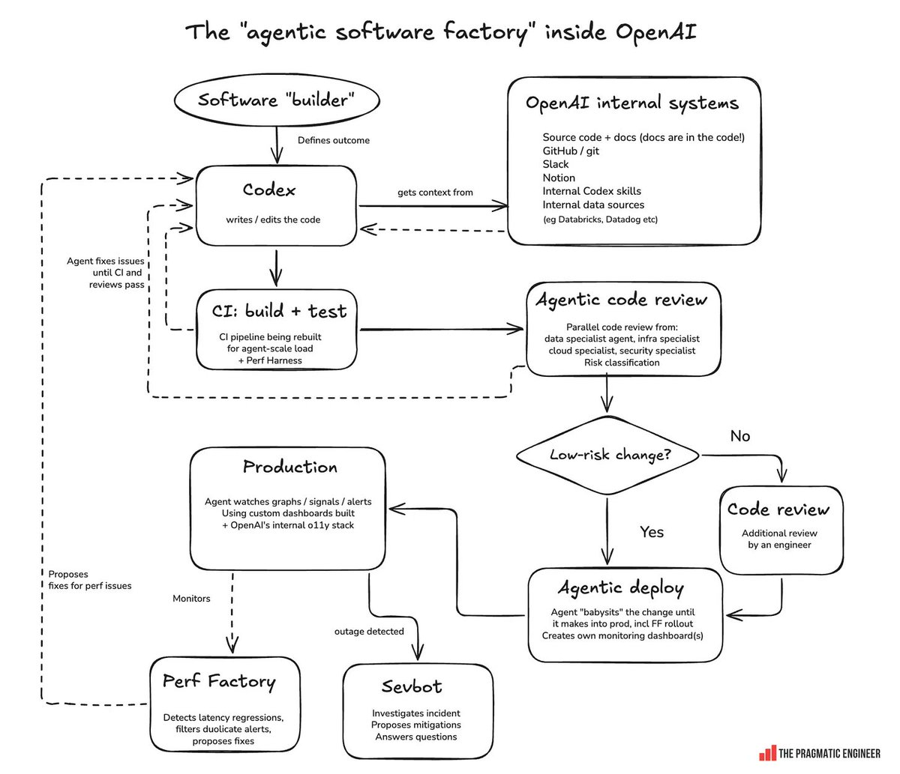

Everything in the workshop so far has been one builder directing a few agents. This closing segment shows the same pattern run by an engineering organization all day. In September 2026, Gergely Orosz published an account of what OpenAI internally calls its agentic software factory.

{fig-alt="A flow diagram. A software builder defines an outcome for Codex, which writes code using context from internal systems. Code goes to CI build and test, then to parallel agentic code review by specialist agents that classify risk. Low-risk changes go to agentic deploy; higher-risk changes get an engineer review first. Deployed changes are watched in production, with a Perf Factory agent detecting latency regressions and a Sevbot agent investigating incidents. Both feed fixes back to Codex."}

Trace the diagram. A human, labeled the **software builder**, defines the outcome. Everything downstream is an agent. Codex writes the code, pulling context from where it lives: the repo, GitHub, Slack, Notion, internal data sources. CI (continuous integration, a system that builds and tests every change automatically) runs, and when it fails the agent fixes its own work and tries again instead of handing a failed build back to a person. Specialist agents review in parallel, one for data, one for infrastructure, one for security, and classify how risky the change is. Only risky changes go to a human engineer. Low-risk changes go straight to an agent that deploys them, monitors the rollout, and builds its own monitoring dashboard. Two more agents watch production: Perf Factory catches latency regressions (changes that make the product slower to respond) and proposes fixes, and Sevbot investigates incidents and proposes mitigations. Both send their fixes back to Codex.

Figures from the same piece: use of Codex in non-engineering departments at OpenAI went from roughly zero to about 90 percent between February and May 2026, nearly everyone at the company uses it weekly, and pull request volume across the company rose roughly tenfold in six months.

## Three things worth a PM's attention

**The human's job is the outcome.** There is one oval at the top, and it is a definition of done. That is the job you practiced in [From Spec to Release](13-spec-to-release.qmd) when you wrote acceptance criteria before letting the agent build. The scarce skill in this picture is judgment about what should be built and what "good" means.

**Verification is the bottleneck.** Most of the diagram is CI, review, risk classification, deploy monitoring, and incident response. When writing code gets cheap, everything that checks the code becomes the constraint.

{#fig-ci-run fig-alt="Two parts. Top: what one CI run does. A git push sends the latest commit to GitHub, and an arrow leads into a panel labeled GitHub Actions runner, a fresh virtual machine, holding four numbered steps in order: check out the code, install packages, build the app, run the tests. From the last step, one arrow leads to a green check labeled pass, and another to a red X labeled fail. Bottom: two horizontal bars on one scale of 0 to 51 minutes, labeled illustrative. One change, by a person: writing code, 41 min, then CI, 10 min; 51 minutes in all. One change, by an AI agent: writing code, 3 min, then CI, 10 min; 13 minutes in all. The CI segment is the same length in both bars, so for the agent it is most of the time the change takes." width="100%"}

| Term | What it means |
|---|---|
| GitHub Actions | GitHub's CI service. A file in `.github/workflows/` lists the steps and when to run them, such as on every push |
| Runner | The machine that runs the steps. GitHub starts a fresh virtual machine for each run and deletes it afterward, so nothing left on your laptop can make the app pass by accident |
| Build | Turning source code into the files that run. It fails on errors such as a missing file or a type error |
| Tests | Programs written ahead of time that run parts of the app and check the results. They catch only what someone wrote a test for |

**Risk classification decides where the human goes.** The diamond in the middle is the design decision that makes the system work. Not every change needs a person, and sending every change to one moves the bottleneck to that person. Deciding which changes deserve your attention is the [blast-radius](11-the-harness.qmd#blast-radius) judgment: how far does it reach, and can it be undone?

## You are running a small version of this factory

Each part of the factory has a counterpart in the [Agent Team Kit](12-agent-team-kit.qmd) covered in the workshop.

| Factory | Agent Team Kit |
|---|---|
| **CI gates**: checks every change must pass | Hooks and permission rules. `bash-guard` blocks commands that discard work or stage other sessions' files; the file-size check flags a file that has grown too large; the `pre-commit` and `pre-push` git hooks run the architecture check, typecheck, and tests before work leaves your laptop |
| **Reusable agent procedures** | Skills. `/spec` writes a spec and stops for approval, `/build-spec` builds it against the acceptance criteria, `/stage` puts a build on staging, and `/promote` ships exactly the commit staging served. `/push` is the short road for small, safe changes |
| **The context layer**: what Codex pulls from Slack and Notion | CLAUDE.md for standing rules, and team memory (`.claude/team-memory/`), which every teammate's session loads at start. `/share-memory` promotes a lesson from your personal memory into it. MCP servers connect the other tools your context lives in |
| **Review** | The verification rules: the definition-of-done section the installer adds to CLAUDE.md, [verify proportional to risk](https://github.com/ai-foundry-byu/agent-team-kit/blob/main/memory-pack/verify-proportional-to-risk.md), and [verify with the real build](https://github.com/ai-foundry-byu/agent-team-kit/blob/main/memory-pack/verify-with-the-real-build.md). `/regression-check` tests the other features that share the code you changed, and `/ux-critique` drives the app in a browser and records where it does not do what a user would expect |
| **Risk classification** | Your choice between the two roads: `/push` straight to production, or `/stage` then `/promote` for migrations, outward writes, and anything a pilot user should try first |

Only the scale differs.

## After the workshop

1. **Install the kit in one real project.** Commit first, then from the project root:

    ```bash
    gh repo clone ai-foundry-byu/agent-team-kit /tmp/agent-team-kit
    /tmp/agent-team-kit/install.sh "$PWD"
    rm -rf /tmp/agent-team-kit
    ```

    Review the diff it makes. The [Kit Reference](90-kit-reference.qmd) lists every piece.
2. **Add one deny rule and one ask rule** for the actions in your project that leave your laptop, and run the push drill from [The Harness](11-the-harness.qmd#advice-versus-enforcement) to see them hold.
3. **Write your next feature as a spec** with `/spec`, and build it with `/build-spec`.
4. **Read further.** The kit repo, [github.com/ai-foundry-byu/agent-team-kit](https://github.com/ai-foundry-byu/agent-team-kit), has the design notes behind every hook and skill. Scott's [Product Management book](https://byu-strategy.github.io/product-management/) covers the full builder workflow, including [Directing the Agent](https://byu-strategy.github.io/product-management/02-directing-the-agent.html), which this afternoon's material is drawn from.
