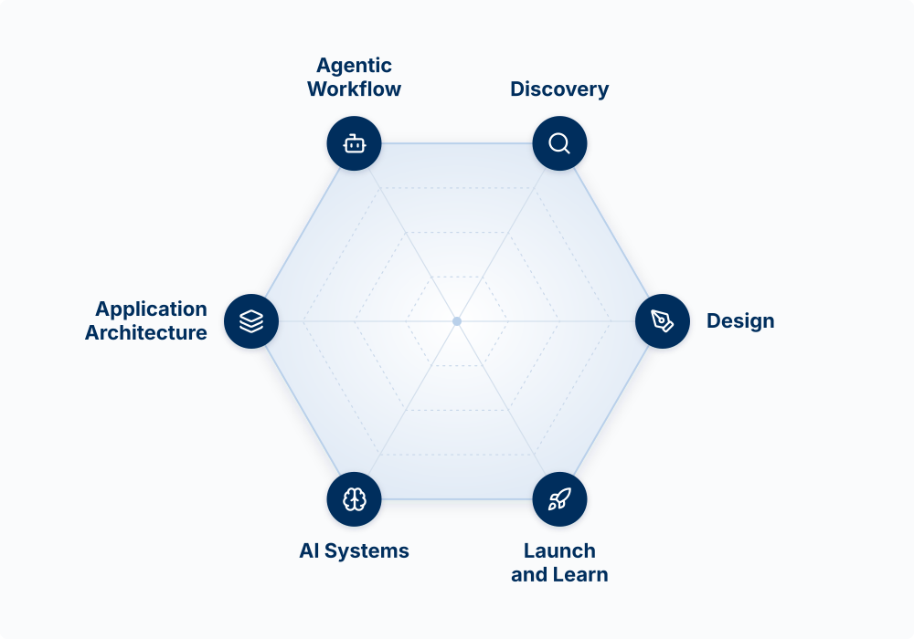

## What this workshop is

This workshop assumes you already build with Claude Code, or with Codex or Copilot at work. It covers what most people who use these tools every day have not set up yet: choosing the right surface for the job, how the harness around the model works and which parts of it you control, rules and hooks the agent cannot ignore, running several agents at once without them breaking each other's work, and taking a feature from a written spec to a controlled release.

Most of the workshop is built around the **Agent Team Kit**, an open-source set of hooks, skills, and working agreements for a small team (or one person) running many Claude Code agents in parallel. It is public at [github.com/ai-foundry-byu/agent-team-kit](https://github.com/ai-foundry-byu/agent-team-kit), and you will install it on your own repo in the lab.

## Two tracks

| Track | Who it is for | How it runs |
|---|---|---|
| **Start Here** | Anyone who is not yet comfortable directing Claude Code: writing a `CLAUDE.md`, using skills, committing and deploying | Self-paced. Work through it before the workshop |
| **Workshop** | Everyone | Taught live, with a hands-on lab |

If you can already start Claude Code in a repo, explain what `CLAUDE.md` does, and push a change to GitHub, skip to [One Engine, Many Surfaces](10-surfaces.qmd).

## The full-stack product builder

The premise behind this workshop is that with AI coding agents, one person can take a product from an idea to live software that customers use. We call that person a **full-stack product builder**. The model has six skills:

{fig-alt="A hexagon with one builder axis at each corner, clockwise from the upper left: Agentic Workflow, Discovery, Design, Launch and Learn, AI Systems, and Application Architecture, each with an icon. Faint rings inside mark levels from the center to the edge." fig-align="center" width="70%"}

| Skill | The question it answers |
|---|---|
| **Agentic Workflow** | How do I put AI to work, as the way I build and inside the product? |
| **Discovery** | What should I build, for whom, and should I? |
| **Design** | What does the surface look like, how does it flow, and how do I write it down so an agent can build it? |
| **Application Architecture** | How is it structured, shipped, and kept safe? |
| **AI Systems** | How do the models work, and why do they behave the way they do? |
| **Launch and Learn** | How do people find it, and did it work? |

The workshop is mostly **Agentic Workflow**, with parts of Design (specs and mockups) and Application Architecture (environments and releases). The full semester version of all six is the BYU course [Product Management](https://byu-strategy.github.io/product-management/), which this site draws from.

## Agenda

Three hours in all.

| Minutes | Segment | Page |
|---|---|---|
| 10 | Welcome and the builder model | This page |
| 20 | One engine, many surfaces | [Surfaces](10-surfaces.qmd) |
| 40 | Understanding the harness: the three rings, rules, hooks, tools, subagents, blast radius | [The Harness](11-the-harness.qmd) |
| 10 | Break | |
| 35 | The Agent Team Kit: parallel agents without collisions | [Agent Team Kit](12-agent-team-kit.qmd) |
| 25 | From spec to release | [Spec to Release](13-spec-to-release.qmd) |
| 30 | Lab: install the kit and run it | [Lab](14-lab.qmd) |
| 10 | What this looks like at full scale, and questions | [Full Scale](15-software-factory.qmd) |

## What to bring

- A laptop with Claude Code installed and signed in to a paid Claude plan ([Setup](00-setup.qmd))
- A GitHub account, with the GitHub CLI (`gh`) signed in
- A repo you are willing to install the kit into: one of your own projects, or a fresh scratch app

## Instructor

Scott Murff is an Associate Teaching Professor of Strategy at the BYU Marriott School of Business, where he directs the Strategic Management program and teaches courses on strategy, product management, and artificial intelligence. He has over 15 years of experience at the intersection of business and technology as a consultant, product manager, and data scientist.

Before BYU, Scott spent nearly seven years at McKinsey & Company in roles ranging from analytics specialist consultant to principal product manager, leading product development and performance management work for Fortune 500 clients. Earlier he built forecasting models as a VP at Zions Bancorporation and did regulatory research at the U.S. Office of the Comptroller of the Currency.

Scott holds a master's degree in Management Science and Engineering from Stanford University and a B.A. in Economics with a minor in Mathematics from BYU.
