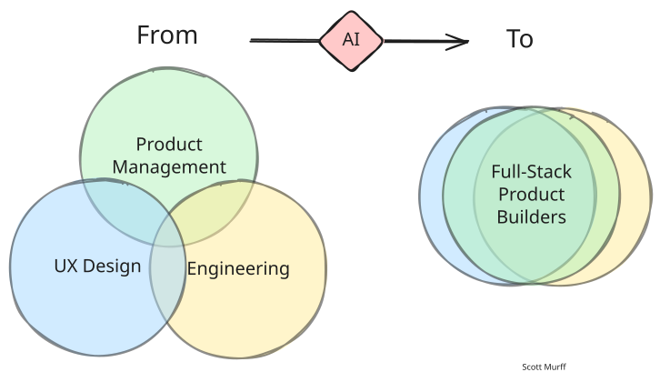
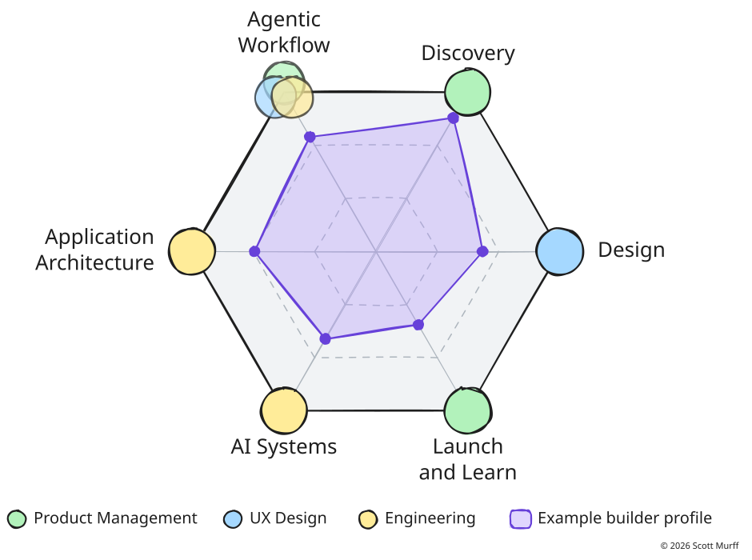

## What this workshop is

This workshop assumes you already build with Claude Code, or with Codex or Copilot at work. It covers what most people who use these tools every day have not set up yet: how the harness around the model works and which parts of it you control, choosing the right surface for the job, rules and hooks the agent cannot ignore, running several agents at once without them breaking each other's work, and taking a feature from a written spec to a controlled release.

Most of the workshop is built around the **Agent Team Kit**, an open-source working setup for building real software with Claude Code agents: running several at once without collisions, fast mockup and prototype rounds, tending agents from your phone, guardrails, memory that carries between sessions, one-click bug reports an agent can fix, and agents that test your app. It is public at [github.com/ai-foundry-byu/agent-team-kit](https://github.com/ai-foundry-byu/agent-team-kit), and you will install it on your own repo in the lab.

## Two tracks

| Track | Who it is for | How it runs |
|---|---|---|
| **Start Here** | Anyone who is not yet comfortable directing Claude Code: writing a `CLAUDE.md`, using skills, committing and deploying | Self-paced. Work through it before the workshop |
| **Workshop** | Everyone | Taught live, with a hands-on lab |

If you can already start Claude Code in a repo, explain what `CLAUDE.md` does, and push a change to GitHub, skip to [Understanding the Harness](10-the-harness.qmd).

::: {.callout-tip title="Learning a section with Claude"}
Sections that state a model have a **Learn in Claude** button beside the heading. Click it to copy a prompt, then paste it into Claude Code in any repo. Claude tutors you on that section for as long as you choose and saves a short learning log to a `learning/` folder in that repo. The first time, it installs the `/learn` skill into your personal skills folder.
:::

## The full-stack product builder

The premise behind this workshop is that with AI coding agents, one person can take a product from an idea to live software that customers use. Product management, UX design, and engineering used to be three jobs held by three people. AI lets one person work across all three, and we call that person a **full-stack product builder**. We describe what that person can do with six skills, each drawn from one or more of the three jobs:

::: {layout="[[44,56]]" layout-valign="center"}
{fig-alt="Hand-drawn diagram. On the left, labeled From, three overlapping circles: Product Management (green) on top, UX Design (blue) and Engineering (yellow) below, overlapping only at the edges. An arrow through a pink diamond labeled AI points right to To: the same three circles stacked almost entirely on top of each other, labeled Full-Stack Product Builders."}

{fig-alt="Hand-drawn hexagon with a skill at each corner: Agentic Workflow at the upper left, then clockwise Discovery, Design, Launch and Learn, AI Systems, and Application Architecture. Each corner has a colored dot for the job it comes from: Discovery and Launch and Learn green for product management, Design blue for UX design, Application Architecture and AI Systems yellow for engineering, and Agentic Workflow all three overlapping. Inside the hexagon, a semi-transparent purple shape marks one example builder's profile, reaching furthest toward Discovery and Agentic Workflow and least toward Launch and Learn."}
:::

| Skill | The question it answers |
|---|---|
| **Agentic Workflow** | How do I put AI to work, as the way I build and inside the product? |
| **Discovery** | What should I build, for whom, and should I? |
| **Design** | What does the surface look like, how does it flow, and how do I write it down so an agent can build it? |
| **Application Architecture** | How is it structured, shipped, and kept safe? |
| **AI Systems** | How do the models work, and why do they behave the way they do? |
| **Launch and Learn** | How do people find it, and did it work? |

The workshop is mostly **Agentic Workflow**, with parts of Design (specs and mockups) and Application Architecture (environments and releases). The full semester version of all six is the BYU course [Product Management](https://byu-strategy.github.io/product-management/), which this site draws from.

## Agenda

Three hours in all.

| Minutes | Segment | Page |
|---|---|---|
| 10 | Welcome and the builder model | This page |
| 40 | Understanding the harness: the three rings, what the model reads, what the harness applies, the tools you add, blast radius | [The Harness](10-the-harness.qmd) |
| 20 | One engine, many surfaces, and other coding agents | [Surfaces](11-surfaces.qmd) |
| 10 | Break | |
| 35 | The Agent Team Kit: concurrent agents, design loops, guardrails, memory, testing | [Agent Team Kit](12-agent-team-kit.qmd) |
| 25 | From spec to release | [Spec to Release](13-spec-to-release.qmd) |
| 30 | Lab: install the kit and run it | [Lab](14-lab.qmd) |
| 10 | What this looks like at full scale, and questions | [Full Scale](15-software-factory.qmd) |

## What to bring

- A laptop with Claude Code installed and signed in to a paid Claude plan ([Setup](00-setup.qmd))
- A GitHub account, with the GitHub CLI (`gh`) signed in
- A repo you are willing to install the kit into: one of your own projects, or a fresh scratch app

## Instructor

Scott Murff is an Associate Teaching Professor of Strategy at the BYU Marriott School of Business, where he directs the Strategic Management program and teaches courses on strategy, product management, and artificial intelligence. He has over 15 years of experience at the intersection of business and technology as a consultant, product manager, and data scientist.

Before BYU, Scott spent nearly seven years at McKinsey & Company in roles ranging from analytics specialist consultant to principal product manager, leading product development and performance management work for Fortune 500 clients. Earlier he built forecasting models as a VP at Zions Bancorporation and did regulatory research at the U.S. Office of the Comptroller of the Currency.

Scott holds a master's degree in Management Science and Engineering from Stanford University and a B.A. in Economics with a minor in Mathematics from BYU.
